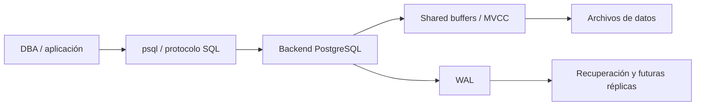
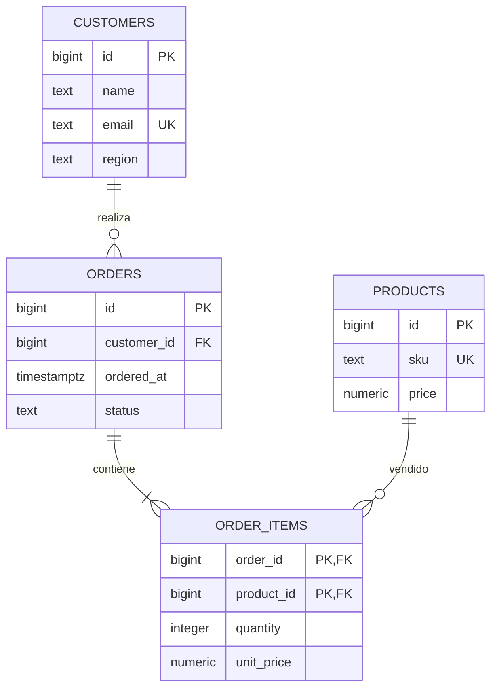

# Capítulo 1. Introducción y arquitectura de PostgreSQL


*El cliente se conecta al servidor; la memoria, las tablas y el WAL sostienen la operaci?n de la base empresarial.*

[Inicio](../README.md) · [Siguiente: operación](../Capitulo02/README.md)

**Práctica 1.1 — instalación en Linux y base empresarial.** Capítulo: 180 min; laboratorio: 100 min. Nivel: aplicar. Distribución práctica: preparación 15, instalación 20, arquitectura y psql 15, modelo y carga 35, validación 15 minutos.

## Misión y fundamentos

Distribuidora Andina necesita una base transaccional para registrar clientes, catálogo y pedidos. Usted entrega el servidor y la **base del proyecto**, no solamente una instalación vacía.

PostgreSQL es un proyecto comunitario. Una versión mayor puede requerir migración; una actualización menor mantiene el formato de datos de esa versión mayor. El clúster es una instancia con varias bases y roles compartidos; un esquema organiza objetos dentro de una base. Cada conexión utiliza un proceso backend. MVCC permite observar versiones consistentes; el WAL registra cambios para durabilidad y recuperación; los buffers y checkpoints coordinan memoria y almacenamiento. Un respaldo requiere un procedimiento consistente: copiar el directorio activo con `cp` no lo garantiza.



Objetivos: instalar PostgreSQL 16; distinguir cliente/servidor/clúster/base/esquema; localizar configuración y WAL; operar `psql`; crear relaciones y restricciones; validar una venta de principio a fin.

## Requisitos y preparación — en pg-primary

Use una VM Ubuntu Server 22.04 o 24.04 con `sudo`, Internet, 4 GB RAM y 40 GB libres. Asigne la IP privada `192.168.56.10` desde su hipervisor o configuración de red. Mantenga disponible la consola de la VM. Los otros equipos se incorporan más adelante.

```bash
cat /etc/os-release
ip -br -4 address
df -h
free -h
sudo hostnamectl set-hostname pg-primary
sudo timedatectl set-timezone UTC
sudo apt update
sudo apt install -y curl ca-certificates postgresql-common openssh-server
sudo systemctl enable --now ssh
```

Verifique que el sistema sea Ubuntu y que la IP esté asignada. Los nombres se pueden registrar en `/etc/hosts`: `192.168.56.10 pg-primary`, `192.168.56.11 pg-standby`, `192.168.56.20 sql-source`. Los comandos de red posteriores usan IP y no dependen de estas entradas.

## Paso 1. Instalar y comprobar PostgreSQL 16

El asistente de `postgresql-common` configura PGDG. Consulte el comando de instalación y el repositorio en la [guía oficial para Ubuntu](https://www.postgresql.org/download/linux/ubuntu/).

```bash
sudo /usr/share/postgresql-common/pgdg/apt.postgresql.org.sh
sudo apt update
sudo apt install -y postgresql-16 postgresql-client-16
sudo systemctl enable --now postgresql
pg_lsclusters
/usr/lib/postgresql/16/bin/psql --version
sudo -u postgres /usr/lib/postgresql/16/bin/psql -X -c 'SELECT version();'
```

Resultado esperado: clúster `16/main`, puerto `5432`, estado `online`; servidor 16.x. Registre el parche real. Si otro clúster ocupa 5432, resuelva la asignación antes de continuar; los laboratorios presuponen `16/main` en 5432. La versión del cliente por sí sola no demuestra la del servidor.

## Paso 2. Reconocer arquitectura y usar psql

```bash
sudo -u postgres psql -X -p 5432 -d postgres
```

Dentro de `psql`:

```sql
\set ON_ERROR_STOP on
\conninfo
\l
\du
SHOW server_version;
SHOW data_directory;
SHOW config_file;
SHOW hba_file;
SHOW TimeZone;
SELECT pid, backend_type, datname, state
FROM pg_stat_activity ORDER BY backend_type, pid;
\q
```

En Ubuntu, normalmente los datos están en `/var/lib/postgresql/16/main`, la configuración en `/etc/postgresql/16/main` y el registro en `/var/log/postgresql/`. Use las rutas devueltas por el servidor como evidencia.

```bash
sudo pg_ctlcluster 16 main status
sudo -u postgres ls -ld /var/lib/postgresql/16/main/pg_wal
```

Identifique un backend de cliente y un proceso de fondo. Explique por qué `pg_wal` tiene un papel diferente al log textual del servidor.

## Paso 3. Crear propietario y base del proyecto

Conéctese a `postgres` como el administrador local:

```bash
sudo -u postgres psql -X -v ON_ERROR_STOP=1 -d postgres
```

```sql
CREATE ROLE lab_admin LOGIN NOSUPERUSER NOCREATEDB NOCREATEROLE;
\password lab_admin
CREATE DATABASE sales_pg OWNER lab_admin ENCODING 'UTF8' TEMPLATE template0;
ALTER DATABASE sales_pg SET timezone TO 'UTC';
\connect sales_pg
REVOKE CREATE ON SCHEMA public FROM PUBLIC;
SET ROLE lab_admin;
CREATE SCHEMA sales AUTHORIZATION lab_admin;
```

`\password` pide una contraseña sin escribirla en este README. `lab_admin` es propietario del proyecto; las tareas de servidor posteriores usan `postgres`. Ejecute este bloque una sola vez en una instalación limpia. Si el nombre ya existe, inspeccione `\l` y `\du`: no borre una base para forzar la repetición.

## Paso 4. Construir el modelo empresarial

Continúe en la misma sesión, base `sales_pg`, con `SET ROLE lab_admin` activo.



```sql
BEGIN;
CREATE TABLE sales.customers (
    id bigint GENERATED BY DEFAULT AS IDENTITY PRIMARY KEY,
    name text NOT NULL,
    email text NOT NULL UNIQUE,
    region text NOT NULL CHECK (region IN ('NORTE', 'CENTRO', 'SUR'))
);
CREATE TABLE sales.products (
    id bigint GENERATED BY DEFAULT AS IDENTITY PRIMARY KEY,
    sku text NOT NULL UNIQUE,
    name text NOT NULL,
    price numeric(12,2) NOT NULL CHECK (price > 0),
    active boolean NOT NULL DEFAULT true
);
CREATE TABLE sales.orders (
    id bigint GENERATED BY DEFAULT AS IDENTITY PRIMARY KEY,
    customer_id bigint NOT NULL REFERENCES sales.customers(id),
    ordered_at timestamptz NOT NULL DEFAULT CURRENT_TIMESTAMP,
    status text NOT NULL CHECK (status IN ('CONFIRMED', 'SHIPPED', 'CANCELLED'))
);
CREATE TABLE sales.order_items (
    order_id bigint NOT NULL REFERENCES sales.orders(id),
    product_id bigint NOT NULL REFERENCES sales.products(id),
    quantity integer NOT NULL CHECK (quantity > 0),
    unit_price numeric(12,2) NOT NULL CHECK (unit_price > 0),
    PRIMARY KEY (order_id, product_id)
);
CREATE INDEX orders_customer_id_idx ON sales.orders(customer_id);
CREATE INDEX order_items_product_id_idx ON sales.order_items(product_id);
CREATE VIEW sales.order_totals AS
SELECT o.id, o.customer_id, o.ordered_at, o.status,
       COALESCE(SUM(i.quantity * i.unit_price), 0)::numeric(14,2) AS total
FROM sales.orders o
LEFT JOIN sales.order_items i ON i.order_id = o.id
GROUP BY o.id;
COMMIT;
```

El precio de una línea es el pactado al vender; modificar el catálogo no debe alterar una factura histórica. Se calcula el total desde las líneas para evitar dos fuentes de verdad. Las FK preservan integridad; sus índices de consulta se crean explícitamente. `numeric` conserva precisión decimal; `timestamptz` representa un instante. `BY DEFAULT` permitirá preservar los ID históricos durante la migración.

## Paso 5. Cargar datos iniciales

```sql
BEGIN;
INSERT INTO sales.customers(id, name, email, region) VALUES
(1, 'Tecnología Norte', 'compras@norte.example', 'NORTE'),
(2, 'Servicios Centro', 'compras@centro.example', 'CENTRO'),
(3, 'Comercial Sur', 'compras@sur.example', 'SUR');
INSERT INTO sales.products(id, sku, name, price, active) VALUES
(1, 'LAP-01', 'Portátil empresarial', 1200.00, true),
(2, 'DOC-01', 'Base de conexión', 80.00, true),
(3, 'MON-01', 'Monitor', 250.00, true);
INSERT INTO sales.orders(id, customer_id, ordered_at, status) VALUES
(1, 1, '2026-01-10 14:00:00+00', 'CONFIRMED'),
(2, 2, '2026-01-11 15:00:00+00', 'SHIPPED');
INSERT INTO sales.order_items VALUES
(1, 1, 1, 1200.00), (1, 2, 2, 80.00), (2, 3, 2, 250.00);
SELECT setval(pg_get_serial_sequence('sales.customers', 'id'), 3, true);
SELECT setval(pg_get_serial_sequence('sales.products', 'id'), 3, true);
SELECT setval(pg_get_serial_sequence('sales.orders', 'id'), 2, true);
COMMIT;
RESET ROLE;
\dt sales.*
\d sales.orders
SELECT * FROM sales.order_totals ORDER BY id;
SELECT COUNT(*) AS pedidos, SUM(total) AS ventas FROM sales.order_totals;
```

Resultado esperado: pedido 1 = `1360.00`, pedido 2 = `500.00`; total `1860.00`. La siguiente identidad de clientes/productos será 4 y la de pedidos 3. Al insertar ID explícitos las secuencias no avanzan automáticamente; por eso se ajustan.

## Paso 6. Probar una transacción sin alterar la entrega

```sql
SET ROLE lab_admin;
BEGIN;
INSERT INTO sales.orders(customer_id, status)
VALUES (3, 'CONFIRMED') RETURNING id AS test_order_id \gset
INSERT INTO sales.order_items(order_id, product_id, quantity, unit_price)
VALUES (:test_order_id, 2, 1, 80.00);
SELECT * FROM sales.order_totals WHERE id = :test_order_id;
ROLLBACK;
SELECT COUNT(*) FROM sales.orders;
RESET ROLE;
```

Resultado: se observa una venta temporal de 80.00 y quedan 2 pedidos. El valor de una secuencia puede avanzar aun si la transacción se revierte; los huecos son normales.

## Ejercicios y aceptación

1. Use `\dt`, `\dv` y `\d sales.order_items` para explicar claves, vista y restricciones.
2. Consulte ventas por cliente, incluyendo clientes sin pedidos. Solución orientativa:

```sql
SELECT c.id, c.name, COALESCE(SUM(t.total), 0) AS ventas
FROM sales.customers c
LEFT JOIN sales.order_totals t ON t.customer_id = c.id
GROUP BY c.id, c.name ORDER BY c.id;
```

3. En una transacción independiente intente insertar una línea con cantidad 0. Debe fallar por `CHECK`; ejecute `ROLLBACK` inmediatamente. No use esa prueba dentro de la carga inicial.
4. Explique qué ocurriría con el total histórico si se cambiara `sales.products.price`.

| Evidencia | Esperado | Observado |
|---|---|---|
| Clúster y versión | `16/main`, online, 16.x | Pendiente |
| Tablas | 4 en `sales`; vista `order_totals` | Pendiente |
| Conteos | 3 clientes, 3 productos, 2 pedidos, 3 líneas | Pendiente |
| Importe | 1860.00 | Pendiente |
| Transacción de prueba | Revertida; 2 pedidos | Pendiente |

Si `peer authentication failed` aparece al usar `-U lab_admin` por socket, la autenticación local sigue siendo `peer`: use el acceso administrativo indicado y `SET ROLE`; el acceso TCP se configura en el capítulo 2. Si una relación ya existe, detenga la repetición y valide lo realizado. Si el servidor está detenido, revise `pg_lsclusters` y el log antes de reiniciar.

**Entrega:** conserve roles, esquema, tablas y datos. Continúe con el capítulo 2. Referencias: [arquitectura](https://www.postgresql.org/docs/16/tutorial-arch.html), [psql](https://www.postgresql.org/docs/16/app-psql.html), [identidades](https://www.postgresql.org/docs/16/ddl-identity-columns.html).
