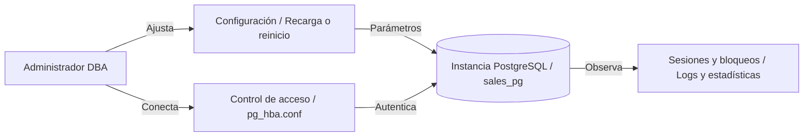
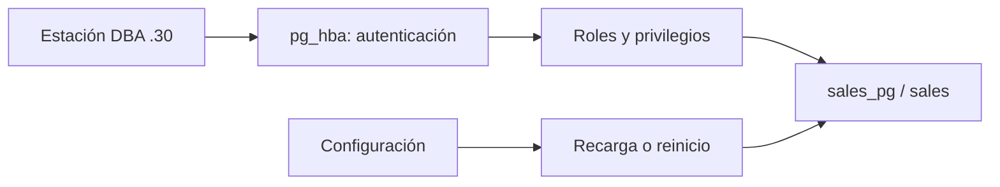

# Capítulo 2. Administración y operación de PostgreSQL



*La operación combina configuración del servidor, autenticación, administración del clúster y observación de sesiones.*

[Anterior](../Capitulo01/README.md) · [Inicio](../README.md) · [Siguiente](../Capitulo03/README.md)

**Práctica 2.1 — operación de la plataforma Andina.** Capítulo: 180 min; práctica: 100 min. Plan: inventario 15, configuración 25, acceso 25, operación 20, aceptación 15 minutos.

## Misión, teoría y requisitos

Reciba `sales_pg` del capítulo 1: 3 clientes, 3 productos, 2 pedidos, 3 líneas y 1860.00 en ventas. Antes de incorporar el histórico, el DBA debe establecer una configuración y una ruta de acceso reproducibles.

`postgresql.conf` contiene parámetros de instancia; `ALTER SYSTEM` escribe `postgresql.auto.conf`. Un parámetro puede requerir recarga o reinicio. `pg_hba.conf` decide autenticación por la **primera regla coincidente**; un `GRANT` autoriza acciones después de autenticar. Detener el clúster afecta todas sus bases. Una conexión administrativa local por `peer` permite reparar el acceso TCP.



Trabaje en `pg-primary` con `sudo`. Todos los SQL de configuración se ejecutan como `postgres` en `sales_pg`:

```bash
sudo -u postgres psql -X -v ON_ERROR_STOP=1 -d sales_pg
```

## Paso 1. Inventariar y fijar la línea base

```sql
\conninfo
SELECT datname, pg_size_pretty(pg_database_size(oid)) AS size
FROM pg_database WHERE NOT datistemplate;
SELECT name, setting, unit, context, source, pending_restart
FROM pg_settings
WHERE name IN ('shared_buffers','work_mem','max_connections','listen_addresses',
               'wal_level','timezone','logging_collector');
SELECT COUNT(*) AS pedidos, SUM(total) AS venta FROM sales.order_totals;
```

Registre tamaños y parámetros antes de modificarlos. Son medidas de la VM, no valores de producción universales.

## Paso 2. Configuración inicial

Perfil de laboratorio para 4 GB RAM y pocos usuarios:

```sql
ALTER SYSTEM SET listen_addresses = 'localhost,192.168.56.10';
ALTER SYSTEM SET shared_buffers = '512MB';
ALTER SYSTEM SET work_mem = '4MB';
ALTER SYSTEM SET max_connections = '60';
ALTER SYSTEM SET timezone = 'UTC';
ALTER SYSTEM SET log_min_duration_statement = '500ms';
ALTER SYSTEM SET log_line_prefix = '%m [%p] %u@%d ';
SELECT pg_reload_conf();
SELECT name, setting, pending_restart FROM pg_settings
WHERE name IN ('listen_addresses','shared_buffers','max_connections','work_mem');
\q
```

La recarga no aplica parámetros de arranque. Cierre sesiones y reinicie durante la ventana del laboratorio:

```bash
sudo pg_ctlcluster 16 main restart
pg_lsclusters
sudo -u postgres psql -X -d sales_pg -c "SHOW listen_addresses;"
sudo -u postgres psql -X -d sales_pg -c "SHOW shared_buffers;"
```

`work_mem` se usa por operación y puede multiplicarse dentro de una consulta y entre sesiones. El cambio de `max_connections` requiere justificar memoria y concurrencia.

## Paso 3. Abrir solo el acceso requerido

Edite el archivo existente; preserve las reglas locales `peer`. Inserte estas reglas **antes** de cualquier regla remota que pueda coincidir. Aquí solo se permite `lab_admin` desde la estación DBA y desde loopback:

```bash
sudo nano /etc/postgresql/16/main/pg_hba.conf
```

```text
host sales_pg lab_admin 127.0.0.1/32 scram-sha-256
host sales_pg lab_admin 192.168.56.30/32 scram-sha-256
```

Desde una sesión local como `postgres`:

```sql
SET password_encryption = 'scram-sha-256';
\password lab_admin
SELECT pg_reload_conf();
SELECT line_number, type, database, user_name, address, auth_method, error
FROM pg_hba_file_rules ORDER BY line_number;
```

No debe aparecer un `error` en las reglas. Si UFW está activo, permita únicamente la estación DBA:

```bash
sudo ufw status
sudo ufw allow from 192.168.56.30 to any port 5432 proto tcp
```

En la estación DBA, use `psql` o su herramienta SQL con la misma conexión:

```bash
psql -X -h 192.168.56.10 -p 5432 -U lab_admin -d sales_pg -W
```

```sql
SELECT current_user, current_database(), inet_client_addr();
SELECT COUNT(*) FROM sales.customers;
```

Resultado: `lab_admin`, `sales_pg`, IP de la estación y 3 clientes. TLS se comprueba y endurece en el capítulo 6.

## Paso 4. Operación y concurrencia

Abra dos terminales locales como `postgres` en `sales_pg`. En A:

```sql
BEGIN;
UPDATE sales.products SET price = price + 1 WHERE id = 1;
-- Mantenga la transacción abierta mientras inspecciona desde B.
```

En B:

```sql
SELECT pid, usename, state, xact_start, wait_event_type, wait_event,
       pg_blocking_pids(pid) AS bloqueadores
FROM pg_stat_activity WHERE datname = 'sales_pg';
SET lock_timeout = '2s';
UPDATE sales.products SET price = price + 1 WHERE id = 1;
```

El `UPDATE` en B debe fallar por tiempo de espera de bloqueo. Ejecútelo como prueba separada sin `ON_ERROR_STOP` para seguir inspeccionando; si el cliente corta la sesión, vuelva a conectarse. En A ejecute `ROLLBACK`; el precio permanece 1200.00. No termine procesos arbitrariamente.

```bash
sudo pg_ctlcluster 16 main status
sudo tail -n 30 /var/log/postgresql/postgresql-16-main.log
```

Dentro de `psql`, fuera de una transacción:

```sql
VACUUM (ANALYZE) sales.products;
SELECT relname, n_live_tup, n_dead_tup, last_analyze, last_autoanalyze
FROM pg_stat_user_tables WHERE schemaname = 'sales';
```

Las estadísticas de filas son estimaciones; para conciliar use `COUNT(*)`.

## Ejercicios, aceptación y entrega

1. Distinga recarga y reinicio usando `context` y `pending_restart`.
2. Explique por qué una regla amplia anterior puede invalidar la intención de una regla específica posterior.
3. Proponga una ventana de mantenimiento: notificación, revisión de sesiones, reinicio, conexión de prueba y revisión de logs.

| Control | Resultado requerido | Observado |
|---|---|---|
| Parámetros | Aplicados; ningún reinicio pendiente de este paso | Pendiente |
| HBA | Sin errores; acceso desde .30 con SCRAM | Pendiente |
| Concurrencia | Bloqueo identificado y transacción A revertida | Pendiente |
| Negocio | 2 pedidos / 1860.00; precio del producto 1 = 1200.00 | Pendiente |

Si hay `connection refused`, revise IP, puerto, servicio y firewall. Si hay `no pg_hba.conf entry`, verifique base, usuario, IP y orden de reglas. Si el reinicio falla, revise `postgresql.auto.conf` y los logs; restituya el parámetro problemático desde la configuración, sin borrar el directorio de datos.

Conserve la configuración y la base para la migración. Referencias: [configuración](https://www.postgresql.org/docs/16/runtime-config.html), [autenticación](https://www.postgresql.org/docs/16/auth-pg-hba-conf.html), [estadísticas](https://www.postgresql.org/docs/16/monitoring-stats.html).
