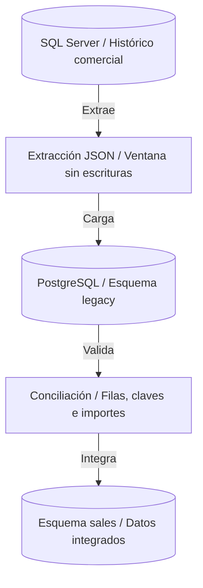
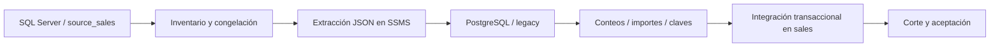

# Capítulo 3. Migración a PostgreSQL desde SQL Server



*El histórico pasa de SQL Server a la zona legacy; solo se integra en sales después de conciliar contenido, claves e importes.*

[Anterior](../Capitulo02/README.md) · [Inicio](../README.md) · [Siguiente](../Capitulo04/README.md)

**Práctica 3.1 — incorporación del histórico empresarial.** Capítulo: 240 min; práctica: 120 min. Plan: estrategia e inventario 15, origen 25, extracción 15, transformación/carga 30, conciliación 25, corte 10 minutos.

## Misión y estrategia

Andina conserva pedidos de diciembre en **SQL Server 2022 Developer**. Se incorporarán a `sales_pg` sin reemplazar los pedidos nuevos. Use una ventana de escritura detenida, carga en `legacy`, validación e integración transaccional en `sales`.

La estrategia es una migración offline pequeña, con transferencia JSON por pantalla para cumplir el formato íntegro en README. Es un ejercicio de extracción, transformación y carga, no un mecanismo de volumen empresarial. Para millones de filas se seleccionaría una herramienta ETL con lotes, registro de rechazos y reconciliación automatizada; CDC reduce la ventana pero requiere gestionar cambios hasta el corte. Un `.bak` de SQL Server no se restaura con PostgreSQL. Procedimientos T-SQL, jobs, collation y semántica de fechas requieren evaluación aparte.



## Requisitos y mapa de conversión

Reciba los datos del capítulo 2 sin cambios. SQL Server debe estar instalado en `sql-source`; conéctese con SSMS y una cuenta con permiso para crear la base de laboratorio. No use una instancia de producción. En el destino se trabaja como `postgres` y `SET ROLE lab_admin`.

| SQL Server | PostgreSQL | Decisión |
|---|---|---|
| `bigint IDENTITY` | `bigint GENERATED BY DEFAULT AS IDENTITY` | Preservar ID y ajustar secuencias |
| `nvarchar` | `text` | Conservar Unicode; cotejamiento se evalúa aparte |
| `decimal(12,2)` | `numeric(12,2)` | Comparar exactamente importes |
| `bit` | `boolean` | `FOR JSON` produce booleanos |
| `datetimeoffset` | `timestamptz` | Usar instantes con offset UTC |
| PK/FK/UNIQUE/CHECK | Restricciones equivalentes | Recrear y comprobar |
| `GO`, `GETDATE`, T-SQL | Separación del cliente / SQL PostgreSQL | No copiar sin adaptación |

Los ID 101–102 y SKU/email distintos evitan colisiones con el capítulo 1. En un proyecto real se requiere una tabla de correspondencias si dos sistemas comparten los mismos ID.

## Paso 1. Crear el origen — T-SQL en SSMS

Ejecute una sola vez. `GO` es separador de lotes del cliente.

```tsql
USE master;
GO
CREATE DATABASE source_sales;
GO
USE source_sales;
GO
CREATE SCHEMA sales AUTHORIZATION dbo;
GO
CREATE TABLE sales.customers (
 id bigint IDENTITY(1,1) PRIMARY KEY,
 name nvarchar(120) NOT NULL,
 email nvarchar(200) NOT NULL UNIQUE,
 region nvarchar(10) NOT NULL CHECK (region IN ('NORTE','CENTRO','SUR'))
);
CREATE TABLE sales.products (
 id bigint IDENTITY(1,1) PRIMARY KEY,
 sku nvarchar(30) NOT NULL UNIQUE,
 name nvarchar(120) NOT NULL,
 price decimal(12,2) NOT NULL CHECK (price > 0),
 active bit NOT NULL DEFAULT 1
);
CREATE TABLE sales.orders (
 id bigint IDENTITY(1,1) PRIMARY KEY,
 customer_id bigint NOT NULL REFERENCES sales.customers(id),
 ordered_at datetimeoffset(0) NOT NULL,
 status nvarchar(20) NOT NULL CHECK (status IN ('CONFIRMED','SHIPPED','CANCELLED'))
);
CREATE TABLE sales.order_items (
 order_id bigint NOT NULL REFERENCES sales.orders(id),
 product_id bigint NOT NULL REFERENCES sales.products(id),
 quantity int NOT NULL CHECK (quantity > 0),
 unit_price decimal(12,2) NOT NULL CHECK (unit_price > 0),
 PRIMARY KEY(order_id,product_id)
);
GO
SET XACT_ABORT ON;
BEGIN TRANSACTION;
SET IDENTITY_INSERT sales.customers ON;
INSERT INTO sales.customers(id,name,email,region) VALUES
(101,N'Logística Norte','historico@norte.example','NORTE'),
(102,N'Distribución Sur','historico@sur.example','SUR');
SET IDENTITY_INSERT sales.customers OFF;
SET IDENTITY_INSERT sales.products ON;
INSERT INTO sales.products(id,sku,name,price,active) VALUES
(101,'HIS-TEC',N'Teclado profesional',150.00,1),
(102,'HIS-IMP',N'Impresora',300.00,1);
SET IDENTITY_INSERT sales.products OFF;
SET IDENTITY_INSERT sales.orders ON;
INSERT INTO sales.orders(id,customer_id,ordered_at,status) VALUES
(101,101,'2025-12-10T14:00:00+00:00','SHIPPED'),
(102,102,'2025-12-11T15:00:00+00:00','SHIPPED');
SET IDENTITY_INSERT sales.orders OFF;
INSERT INTO sales.order_items VALUES
(101,101,2,150.00),(101,102,1,300.00),(102,101,2,150.00);
COMMIT;
GO
```

Resultado: 2 clientes, 2 productos, 2 pedidos, 3 líneas y venta histórica 900.00.

## Paso 2. Inventariar y capturar una extracción consistente

En SSMS, `source_sales`:

```tsql
SELECT TABLE_SCHEMA,TABLE_NAME,COLUMN_NAME,DATA_TYPE,IS_NULLABLE
FROM INFORMATION_SCHEMA.COLUMNS WHERE TABLE_SCHEMA='sales'
ORDER BY TABLE_NAME,ORDINAL_POSITION;
SELECT name,type_desc FROM sys.objects
WHERE schema_id=SCHEMA_ID('sales') AND is_ms_shipped=0;
SELECT 'customers' AS tabla,COUNT(*) AS filas FROM sales.customers
UNION ALL SELECT 'products',COUNT(*) FROM sales.products
UNION ALL SELECT 'orders',COUNT(*) FROM sales.orders
UNION ALL SELECT 'order_items',COUNT(*) FROM sales.order_items;
SELECT order_id,SUM(quantity*unit_price) AS total
FROM sales.order_items GROUP BY order_id ORDER BY order_id;
SELECT SUM(quantity) AS unidades,SUM(quantity*unit_price) AS venta
FROM sales.order_items;
```

Espere importes 600.00/300.00, 5 unidades, 900.00. Confirme con el responsable funcional que no habrá escrituras. La transacción siguiente además mantiene una extracción consistente durante las cuatro lecturas:

```tsql
SET TRANSACTION ISOLATION LEVEL SERIALIZABLE;
BEGIN TRANSACTION;
SELECT
 JSON_QUERY((SELECT id,name,email,region FROM sales.customers ORDER BY id FOR JSON PATH)) AS customers,
 JSON_QUERY((SELECT id,sku,name,price,active FROM sales.products ORDER BY id FOR JSON PATH)) AS products,
 JSON_QUERY((SELECT id,customer_id,ordered_at,status FROM sales.orders ORDER BY id FOR JSON PATH)) AS orders,
 JSON_QUERY((SELECT order_id,product_id,quantity,unit_price FROM sales.order_items
             ORDER BY order_id,product_id FOR JSON PATH)) AS order_items
FOR JSON PATH, WITHOUT_ARRAY_WRAPPER;
COMMIT;
SET TRANSACTION ISOLATION LEVEL READ COMMITTED;
```

Abra la celda JSON en SSMS y copie **todo** el objeto; aumente el límite de caracteres del resultado si se trunca. No copie encabezados, mensajes ni una representación parcial. [Microsoft documenta `FOR JSON`](https://learn.microsoft.com/en-us/sql/relational-databases/json/format-query-results-as-json-with-for-json-sql-server).

## Paso 3. Cargar la zona de transición — PostgreSQL

En `pg-primary`:

```bash
sudo -u postgres psql -X -v ON_ERROR_STOP=1 -d sales_pg
```

```sql
SET ROLE lab_admin;
CREATE SCHEMA legacy AUTHORIZATION lab_admin;
CREATE TABLE legacy.customers (LIKE sales.customers INCLUDING ALL);
CREATE TABLE legacy.products (LIKE sales.products INCLUDING ALL);
CREATE TABLE legacy.orders (LIKE sales.orders INCLUDING ALL);
CREATE TABLE legacy.order_items (LIKE sales.order_items INCLUDING ALL);
ALTER TABLE legacy.orders ADD FOREIGN KEY(customer_id) REFERENCES legacy.customers(id);
ALTER TABLE legacy.order_items ADD FOREIGN KEY(order_id) REFERENCES legacy.orders(id);
ALTER TABLE legacy.order_items ADD FOREIGN KEY(product_id) REFERENCES legacy.products(id);
CREATE TEMP TABLE migration_payload(doc jsonb NOT NULL);
```

`LIKE INCLUDING ALL` copia identidades y restricciones locales, pero no las FK; las agregamos con destino a `legacy`. Pegue el JSON obtenido en SQL Server entre `$json$`. Este es el objeto completo esperado para el origen suministrado; compruebe que coincide con la extracción real:

```sql
INSERT INTO migration_payload VALUES ($json$
{
 "customers":[
  {"id":101,"name":"Logística Norte","email":"historico@norte.example","region":"NORTE"},
  {"id":102,"name":"Distribución Sur","email":"historico@sur.example","region":"SUR"}],
 "products":[
  {"id":101,"sku":"HIS-TEC","name":"Teclado profesional","price":150.00,"active":true},
  {"id":102,"sku":"HIS-IMP","name":"Impresora","price":300.00,"active":true}],
 "orders":[
  {"id":101,"customer_id":101,"ordered_at":"2025-12-10T14:00:00+00:00","status":"SHIPPED"},
  {"id":102,"customer_id":102,"ordered_at":"2025-12-11T15:00:00+00:00","status":"SHIPPED"}],
 "order_items":[
  {"order_id":101,"product_id":101,"quantity":2,"unit_price":150.00},
  {"order_id":101,"product_id":102,"quantity":1,"unit_price":300.00},
  {"order_id":102,"product_id":101,"quantity":2,"unit_price":150.00}]
}
$json$::jsonb);
BEGIN;
INSERT INTO legacy.customers(id,name,email,region)
SELECT x.* FROM migration_payload p,
jsonb_to_recordset(p.doc->'customers') x(id bigint,name text,email text,region text);
INSERT INTO legacy.products(id,sku,name,price,active)
SELECT x.* FROM migration_payload p,
jsonb_to_recordset(p.doc->'products') x(id bigint,sku text,name text,price numeric,active boolean);
INSERT INTO legacy.orders(id,customer_id,ordered_at,status)
SELECT x.* FROM migration_payload p,
jsonb_to_recordset(p.doc->'orders') x(id bigint,customer_id bigint,ordered_at timestamptz,status text);
INSERT INTO legacy.order_items(order_id,product_id,quantity,unit_price)
SELECT x.* FROM migration_payload p,
jsonb_to_recordset(p.doc->'order_items') x(order_id bigint,product_id bigint,quantity integer,unit_price numeric);
COMMIT;
```

Si hay un error, ejecute `ROLLBACK`, identifique la fila y corrija la causa. No desactive FK ni elimine duplicados para ocultar rechazos. No repita una carga exitosa: debe fallar por claves duplicadas si se intenta otra vez.

## Paso 4. Conciliar antes del corte

```sql
SELECT 'customers' AS tabla,COUNT(*) AS filas FROM legacy.customers
UNION ALL SELECT 'products',COUNT(*) FROM legacy.products
UNION ALL SELECT 'orders',COUNT(*) FROM legacy.orders
UNION ALL SELECT 'order_items',COUNT(*) FROM legacy.order_items;
SELECT order_id,SUM(quantity*unit_price) AS total
FROM legacy.order_items GROUP BY order_id ORDER BY order_id;
SELECT SUM(quantity) AS unidades,SUM(quantity*unit_price) AS venta FROM legacy.order_items;
SELECT conrelid::regclass,conname,contype,convalidated FROM pg_constraint
WHERE connamespace='legacy'::regnamespace ORDER BY 1,2;
-- Cada tabla debe devolver cero diferencias de contenido.
WITH
src_customers AS (
 SELECT x.* FROM migration_payload p,
 jsonb_populate_recordset(NULL::legacy.customers,p.doc->'customers') x
),
src_products AS (
 SELECT x.* FROM migration_payload p,
 jsonb_populate_recordset(NULL::legacy.products,p.doc->'products') x
),
src_orders AS (
 SELECT x.* FROM migration_payload p,
 jsonb_populate_recordset(NULL::legacy.orders,p.doc->'orders') x
),
src_items AS (
 SELECT x.* FROM migration_payload p,
 jsonb_populate_recordset(NULL::legacy.order_items,p.doc->'order_items') x
)
SELECT 'customers' AS tabla,COUNT(*) AS diferencias FROM (
 (TABLE src_customers EXCEPT TABLE legacy.customers)
 UNION ALL (TABLE legacy.customers EXCEPT TABLE src_customers)
) d
UNION ALL
SELECT 'products',COUNT(*) FROM (
 (TABLE src_products EXCEPT TABLE legacy.products)
 UNION ALL (TABLE legacy.products EXCEPT TABLE src_products)
) d
UNION ALL
SELECT 'orders',COUNT(*) FROM (
 (TABLE src_orders EXCEPT TABLE legacy.orders)
 UNION ALL (TABLE legacy.orders EXCEPT TABLE src_orders)
) d
UNION ALL
SELECT 'order_items',COUNT(*) FROM (
 (TABLE src_items EXCEPT TABLE legacy.order_items)
 UNION ALL (TABLE legacy.order_items EXCEPT TABLE src_items)
) d;
```

Compare Unicode, emails, booleanos, offsets y cada total con SQL Server. Como ejercicio, repita la comparación bidireccional para productos, pedidos y líneas utilizando sus definiciones `jsonb_to_recordset` anteriores. La igualdad de conteos no prueba igualdad de contenido. Las restricciones deben estar validadas.

## Paso 5. Integrar y ajustar identidades

Detenga escrituras también en el destino durante este bloque. Las inserciones siguen el orden padre-hijo. La transacción impide entregar un histórico parcialmente integrado:

```sql
BEGIN;
INSERT INTO sales.customers SELECT * FROM legacy.customers;
INSERT INTO sales.products SELECT * FROM legacy.products;
INSERT INTO sales.orders SELECT * FROM legacy.orders;
INSERT INTO sales.order_items SELECT * FROM legacy.order_items;
DO $$
BEGIN
 IF (SELECT COUNT(*) FROM sales.customers) <> 5
 OR (SELECT COUNT(*) FROM sales.products) <> 5
 OR (SELECT COUNT(*) FROM sales.orders) <> 4
 OR (SELECT COUNT(*) FROM sales.order_items) <> 6
 OR (SELECT SUM(total) FROM sales.order_totals) <> 2760.00 THEN
   RAISE EXCEPTION 'Conciliación final fallida: integración cancelada';
 END IF;
END $$;
COMMIT;
-- Ajuste con las escrituras aún detenidas. setval no se revierte con ROLLBACK.
SELECT setval(pg_get_serial_sequence('sales.customers','id'),(SELECT MAX(id) FROM sales.customers),true);
SELECT setval(pg_get_serial_sequence('sales.products','id'),(SELECT MAX(id) FROM sales.products),true);
SELECT setval(pg_get_serial_sequence('sales.orders','id'),(SELECT MAX(id) FROM sales.orders),true);
SELECT setval(pg_get_serial_sequence('legacy.customers','id'),(SELECT MAX(id) FROM legacy.customers),true);
SELECT setval(pg_get_serial_sequence('legacy.products','id'),(SELECT MAX(id) FROM legacy.products),true);
SELECT setval(pg_get_serial_sequence('legacy.orders','id'),(SELECT MAX(id) FROM legacy.orders),true);
SELECT * FROM sales.order_totals ORDER BY id;
RESET ROLE;
```

El próximo ID generado será 103 en las tres tablas del proyecto. Mantenga `legacy` como evidencia hasta finalizar el curso. Una segunda ejecución de la integración falla por PK; no utilice `ON CONFLICT DO NOTHING` para simular éxito.

## Ejercicios, corte y reversión

1. Explique el riesgo de migrar `datetime2` sin conocer la zona horaria. Aquí `datetimeoffset` evita esa ambigüedad.
2. Identifique un procedimiento T-SQL que habría que reescribir y una diferencia de comparación de cadenas que habría que probar.
3. Provoque un ID duplicado en una transacción independiente, observe el rechazo y ejecute `ROLLBACK`.
4. Defina quién autoriza el corte y cuándo se reanudan escrituras. El responsable debe revisar la conciliación, probar consultas de aplicación y verificar que no queden conexiones escribiendo al origen.

Antes de `COMMIT`, la reversión es `ROLLBACK`. Si se requiere retirar el histórico ya integrado **antes de reabrir escrituras**, ejecute una transacción que borre únicamente ID históricos: líneas de pedidos 101/102, luego pedidos 101/102, productos 101/102 y clientes 101/102. Si hay referencias nuevas, las FK deben impedir la retirada; en ese caso diseñe una reversión con los cambios posteriores. Este procedimiento es discusión, no un paso del recorrido: la entrega conserva el histórico.

| Control | Origen | Destino histórico | Destino integrado | Observado |
|---|---:|---:|---:|---|
| Clientes / productos | 2 / 2 | 2 / 2 | 5 / 5 | Pendiente |
| Pedidos / líneas | 2 / 3 | 2 / 3 | 4 / 6 | Pendiente |
| Venta | 900.00 | 900.00 | 2760.00 | Pendiente |
| Contenido, Unicode, fechas | Datos extraídos | Sin diferencias | Preservados | Pendiente |
| Restricciones e identidades | Válidas | Válidas | Próximo ID 103 | Pendiente |

Un JSON truncado falla al convertirse a `jsonb`; revise límites de SSMS. Un conflicto de email/SKU requiere una regla de negocio, no borrar el registro. Una diferencia de importe requiere revisar precisión y líneas; no use tolerancias innecesarias para valores `numeric`.

**Entrega:** histórico integrado y SQL Server conservado para comparación. Referencias: [SQL Server JSON](https://learn.microsoft.com/en-us/sql/relational-databases/json/format-query-results-as-json-with-for-json-sql-server), [funciones JSON PostgreSQL](https://www.postgresql.org/docs/16/functions-json.html), [restricciones](https://www.postgresql.org/docs/16/ddl-constraints.html).
