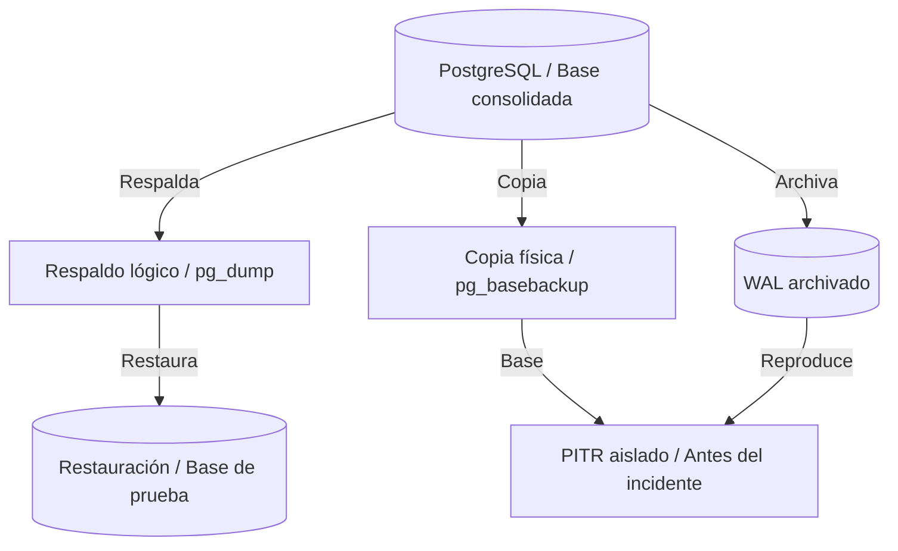
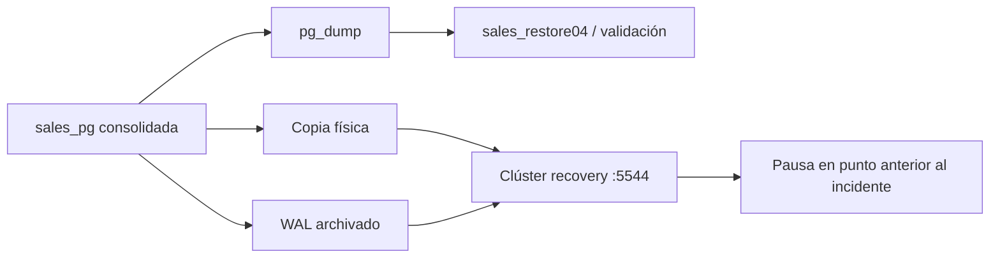

# Capítulo 4. Respaldos y recuperación



*La restauración lógica valida la copia de la base; una copia física y sus WAL permiten recuperar el estado anterior al incidente.*

[Anterior](../Capitulo03/README.md) · [Inicio](../README.md) · [Siguiente](../Capitulo05/README.md)

**Práctica 4.1 — continuidad ante pérdida de datos.** Capítulo: 240 min; práctica: 125 min. Plan: diseño 15, respaldo lógico 25, archivado y copia física 30, PITR 40, aceptación 15 minutos.

## Misión y fundamentos

La base consolidada de Andina tiene 5 clientes, 5 productos, 4 pedidos, 6 líneas y venta 2760.00. Debe demostrar que puede reconstruirse y recuperar un estado anterior a un incidente. El ensayo altera solamente un marcador operativo; las tablas comerciales se mantienen.

`pg_dump` genera un respaldo lógico de una base, útil para restaurar objetos y migrar de versión. Los roles son globales y se respaldan aparte con `pg_dumpall --globals-only`. `pg_basebackup` copia un clúster completo y requiere la misma versión mayor al restaurarlo. PITR combina copia física y una cadena continua de WAL. RPO es la pérdida de datos tolerada; RTO es el tiempo para recuperar servicio. Una réplica también replica errores y no reemplaza un respaldo. [La documentación oficial describe los requisitos de PITR](https://www.postgresql.org/docs/16/continuous-archiving.html).



Requisitos: capítulos 1–3 aceptados, `sudo`, espacio para al menos dos copias del clúster y puerto 5544 libre en `pg-primary`. Los directorios de este laboratorio están en la VM, no en el repositorio. El archivado local enseña el mecanismo; en producción se necesita almacenamiento independiente y política de retención.

## Paso 1. Respaldar y restaurar lógicamente

En `pg-primary`:

```bash
sudo install -d -o postgres -g postgres -m 700 /srv/andina-backups
sudo -u postgres /usr/lib/postgresql/16/bin/pg_dump -Fc \
  -d sales_pg -f /srv/andina-backups/sales04.dump
sudo -u postgres sh -c 'umask 077; /usr/lib/postgresql/16/bin/pg_dumpall --globals-only > /srv/andina-backups/globals04.sql'
sudo -u postgres /usr/lib/postgresql/16/bin/pg_restore -l /srv/andina-backups/sales04.dump
sudo -u postgres createdb -O lab_admin sales_restore04
sudo -u postgres /usr/lib/postgresql/16/bin/pg_restore --exit-on-error \
  -d sales_restore04 /srv/andina-backups/sales04.dump
sudo -u postgres psql -X -d sales_restore04 -c \
  'SELECT COUNT(*) AS pedidos, SUM(total) AS venta FROM sales.order_totals;'
```

Resultado: 4 pedidos / 2760.00. No restaure `globals04.sql` en el mismo clúster, porque los roles ya existen. En un destino vacío se revisan y restauran antes de la base. Proteja el archivo de roles: puede incluir hashes de contraseñas.

## Paso 2. Preparar archivado y marcador

```bash
sudo install -d -o postgres -g postgres -m 700 /srv/andina-wal
sudo -u postgres psql -X -v ON_ERROR_STOP=1 -d sales_pg
```

```sql
CREATE SCHEMA ops AUTHORIZATION lab_admin;
SET ROLE lab_admin;
CREATE TABLE ops.recovery_marker (
 id integer PRIMARY KEY,
 description text NOT NULL
);
RESET ROLE;
ALTER SYSTEM SET wal_level = 'replica';
ALTER SYSTEM SET archive_mode = 'on';
ALTER SYSTEM SET archive_timeout = '60s';
ALTER SYSTEM SET archive_command = 'test ! -f /srv/andina-wal/%f && cp %p /srv/andina-wal/%f';
\q
```

La orden impide sobrescribir un segmento existente. Si se repite un archivado ya presente, verifique que el contenido sea idéntico antes de intervenir; no borre segmentos para eliminar avisos. La política productiva debe tratar reintentos, almacenamiento duradero y alarmas.

```bash
sudo pg_ctlcluster 16 main restart
sudo -u postgres psql -X -d sales_pg -c 'SHOW archive_mode;'
sudo -u postgres psql -X -d sales_pg -c 'SELECT pg_switch_wal();'
sudo -u postgres psql -X -d sales_pg -c \
 'SELECT archived_count,failed_count,last_archived_wal,last_failed_wal FROM pg_stat_archiver;'
```

Espere hasta que `archived_count` aumente y compruebe permisos y log si crece `failed_count`. No tome la copia base antes de verificar el archivado.

## Paso 3. Obtener copia física e identificar el punto válido

`base04` debe ser una ruta nueva/vacía. El socket local usa la regla `local replication postgres peer` de Ubuntu; verifíquela si la conexión es rechazada.

```bash
sudo -u postgres /usr/lib/postgresql/16/bin/pg_basebackup \
  -h /var/run/postgresql -p 5432 -U postgres \
  -D /srv/andina-backups/base04 -Fp -Xs -P
sudo -u postgres /usr/lib/postgresql/16/bin/pg_verifybackup /srv/andina-backups/base04
sudo -u postgres psql -X -v ON_ERROR_STOP=1 -d sales_pg
```

Después de terminar la copia base, cree el marcador y el punto de restauración:

```sql
INSERT INTO ops.recovery_marker VALUES (1,'Estado aprobado antes del incidente');
SELECT pg_create_restore_point('andina_before_incident');
-- Incidente controlado: solo se borra el marcador, no los pedidos.
DELETE FROM ops.recovery_marker WHERE id=1;
SELECT COUNT(*) AS marcadores_actuales FROM ops.recovery_marker;
SELECT pg_walfile_name(pg_current_wal_lsn()) AS wal_to_archive \gset
SELECT pg_switch_wal();
SELECT EXISTS (
 SELECT 1 FROM pg_ls_dir('/srv/andina-wal') AS f(name)
 WHERE name = :'wal_to_archive'
) AS segmento_archivado;
```

El conteo actual es 0. Repita la consulta `EXISTS` hasta que resulte `t`; el archivador trabaja asíncronamente. Conserve el nombre del punto de restauración y el segmento. La copia base y los WAL contienen información sensible del clúster entero.

## Paso 4. Restaurar en un clúster aislado

En otra terminal de `pg-primary`, confirme que el nombre `recovery` y el puerto 5544 no existen. No aplique estos movimientos a `16/main`.

```bash
pg_lsclusters
sudo pg_createcluster 16 recovery --port 5544
sudo pg_ctlcluster 16 recovery status
# El clúster recién creado debe estar detenido y sin datos de usuario.
sudo mv /var/lib/postgresql/16/recovery /var/lib/postgresql/16/recovery.initial04
sudo install -d -o postgres -g postgres -m 700 /var/lib/postgresql/16/recovery
sudo -u postgres cp -a /srv/andina-backups/base04/. /var/lib/postgresql/16/recovery/
sudo -u postgres touch /var/lib/postgresql/16/recovery/recovery.signal
sudo -u postgres tee -a /var/lib/postgresql/16/recovery/postgresql.auto.conf <<'CONF'
port = 5544
listen_addresses = 'localhost'
archive_mode = 'off'
restore_command = 'cp /srv/andina-wal/%f %p'
recovery_target_name = 'andina_before_incident'
recovery_target_action = 'pause'
CONF
sudo pg_ctlcluster 16 recovery start
```

La configuración del clúster auxiliar permanece en `/etc/postgresql/16/recovery`. Las opciones anexadas reemplazan valores copiados del primario; no se archivará desde la copia recuperada hacia el mismo directorio.

```bash
sudo -u postgres psql -X -p 5544 -d sales_pg
```

```sql
SELECT pg_is_in_recovery(), pg_is_wal_replay_paused();
SELECT * FROM ops.recovery_marker;
SELECT COUNT(*) AS pedidos,SUM(total) AS venta FROM sales.order_totals;
```

Espere recuperación activa y replay pausado (`t/t`), marcador 1 presente, 4 pedidos y 2760.00. Revise el log hasta observar que llegó al punto de recuperación. No ejecute `pg_wal_replay_resume`: el objetivo es verificar el estado anterior, no aplicar el borrado posterior.

## Ejercicios y aceptación

1. Defina como objetivo RPO ≤ 1 minuto y RTO ≤ 15 minutos. Mida tiempo real desde inicio de restauración hasta consulta válida; no declare cumplidos los objetivos sin medir.
2. Explique por qué `pg_dump` no permite reproducir WAL y por qué `archive_timeout` no garantiza por sí solo el RPO.
3. Identifique qué faltaría para restaurar si se perdieran el disco de datos **y** `/srv/andina-wal`.
4. Compare tamaños de copia lógica, física y WAL; proponga retención con dependencias entre base y segmentos.

| Control | Esperado | Observado |
|---|---|---|
| Restauración lógica | 4 pedidos / 2760.00 | Pendiente |
| Copia física | `pg_verifybackup` correcto | Pendiente |
| Archivado | Segmento requerido disponible | Pendiente |
| PITR aislado | Marcador presente, replay pausado | Pendiente |
| Tiempo de recuperación | Medido y comparado con RTO | Pendiente |

Si falla `restore_command`, compruebe permisos y segmentos. Si no se alcanza el punto, verifique que fue creado **después** de la copia base y antes del incidente, y que se archivó su WAL. Si 5544 está ocupado, detenga el ensayo y revise qué clúster lo utiliza. Nunca sustituya `PGDATA` del primario para resolver el ensayo.

Cierre la conexión a 5544 y detenga solamente el auxiliar:

```bash
sudo pg_ctlcluster 16 recovery stop
```

Conserve `sales_pg`, copias, WAL y `sales_restore04`; el siguiente capítulo utiliza el primario en 5432. Referencias: [pg_dump](https://www.postgresql.org/docs/16/app-pgdump.html), [pg_basebackup](https://www.postgresql.org/docs/16/app-pgbasebackup.html), [PITR](https://www.postgresql.org/docs/16/continuous-archiving.html).
