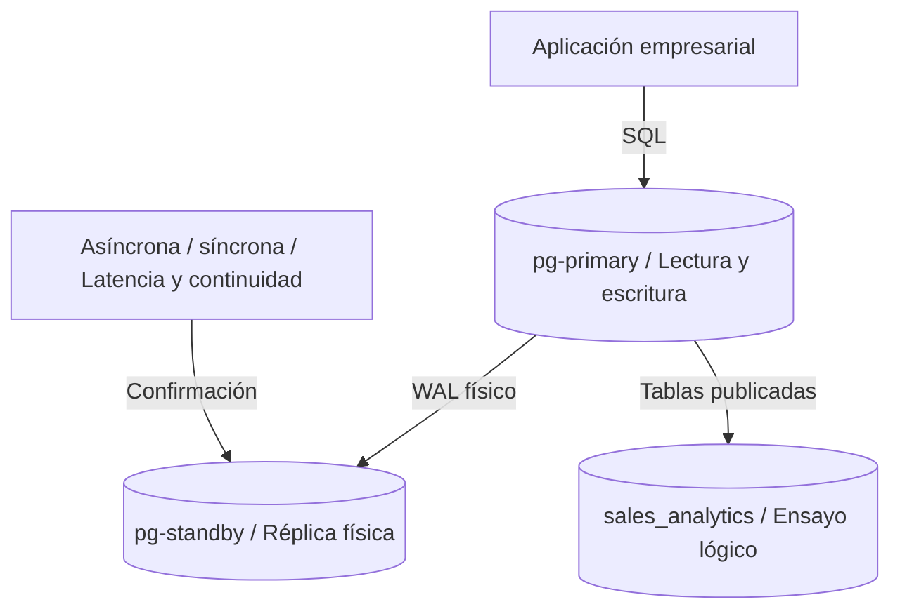
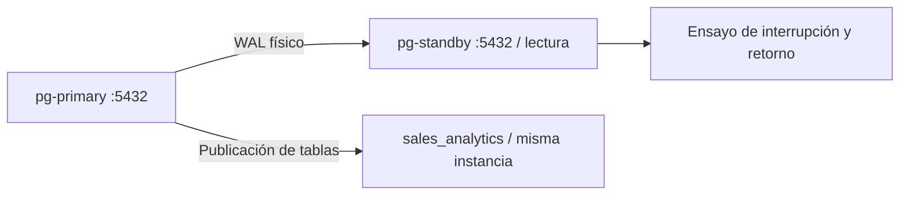

# Capítulo 5. Replicación y alta disponibilidad



*La réplica física recibe el WAL del primario; la réplica lógica distribuye tablas seleccionadas para el ensayo de analítica.*

[Anterior](../Capitulo04/README.md) · [Inicio](../README.md) · [Siguiente](../Capitulo06/README.md)

**Práctica 5.1 — réplica física, sincronía y distribución lógica.** Capítulo: 240 min; práctica: 140 min. Plan: preparar 20, copia física 30, pruebas asíncronas 20, síncronas 25, lógica 30, aceptación 15 minutos.

## Misión y fundamentos

Andina requiere una copia en `pg-standby` y una base de analítica con tablas seleccionadas. La réplica física reproduce el clúster completo a partir del WAL y necesita la misma versión mayor. La réplica lógica publica cambios de tablas y puede alimentar destinos distintos; no copia DDL ni el estado de secuencias. Asíncrona permite confirmación local antes de recepción remota; síncrona puede esperar al standby y reducir disponibilidad si este falla. Alta disponibilidad requiere además detección, fencing y enrutamiento; dos servidores replicando no proporcionan failover automático.



Requisitos: capítulo 4 terminado; `pg-primary` conserva 4 pedidos / 2760.00; `pg-standby` es una VM nueva con PostgreSQL 16 instalado usando el procedimiento del capítulo 1. Verifique versiones: igual mayor, preferiblemente igual parche. El cluster `16/main` del standby debe estar vacío y sin datos valiosos. Puerto 5432 entre .10 y .11 habilitado. La réplica lógica en la misma instancia enseña selección de datos, **no** aislamiento de fallos.

## Paso 1. Preparar el primario

En `pg-primary`, como `postgres`, base `sales_pg`:

```sql
CREATE ROLE repl_user LOGIN REPLICATION NOSUPERUSER;
\password repl_user
CREATE ROLE logical_reader LOGIN REPLICATION NOSUPERUSER;
\password logical_reader
GRANT CONNECT ON DATABASE sales_pg TO logical_reader;
GRANT USAGE ON SCHEMA sales TO logical_reader;
GRANT SELECT ON sales.customers,sales.products,sales.orders,sales.order_items TO logical_reader;
ALTER SYSTEM SET wal_level = 'logical';
ALTER SYSTEM SET max_wal_senders = '10';
ALTER SYSTEM SET max_replication_slots = '10';
ALTER SYSTEM SET max_slot_wal_keep_size = '1GB';
```

`logical` también admite la replicación física. El límite de WAL es para el pequeño laboratorio; si se excede, una ranura puede perder validez y exigir resincronización.

Edite `/etc/postgresql/16/main/pg_hba.conf` en el primario y agregue antes de reglas coincidentes:

```text
host replication repl_user 192.168.56.11/32 scram-sha-256
host sales_pg logical_reader 127.0.0.1/32 scram-sha-256
```

`replication` en HBA cubre conexión física; una conexión lógica utiliza el nombre real de la base. Permita el firewall si está activo:

```bash
sudo ufw allow from 192.168.56.11 to any port 5432 proto tcp
sudo pg_ctlcluster 16 main restart
sudo -u postgres psql -X -d sales_pg -c "SELECT * FROM pg_create_physical_replication_slot('andina_standby');"
```

## Paso 2. Inicializar el standby

Ejecute **en pg-standby**, después de verificar que `16/main` es la instalación vacía:

```bash
pg_lsclusters
sudo pg_ctlcluster 16 main stop
sudo mv /var/lib/postgresql/16/main /var/lib/postgresql/16/main.initial05
sudo install -d -o postgres -g postgres -m 700 /var/lib/postgresql/16/main
sudo -u postgres /usr/lib/postgresql/16/bin/pg_basebackup \
  -h 192.168.56.10 -p 5432 -U repl_user -W \
  -D /var/lib/postgresql/16/main -Fp -Xs -P -R -S andina_standby
```

`-R` crea `standby.signal` y configura conexión y slot; la contraseña pedida no se debe asumir persistida. Configure un archivo de contraseñas del **usuario del sistema postgres** en el standby:

```bash
sudo -u postgres sh -c 'umask 077; touch /var/lib/postgresql/.pgpass'
sudo -u postgres nano /var/lib/postgresql/.pgpass
```

Contenido, sustituyendo el marcador por la contraseña real:

```text
192.168.56.10:5432:replication:repl_user:REEMPLAZAR_CON_PASSWORD_REAL
```

Si la contraseña contiene `:` o `\`, escápelos según `.pgpass`. Verifique modo 600. El archivo reside en la VM y nunca se incluye en Git.

La copia trae `postgresql.auto.conf` del primario. Anexe los valores propios del standby para evitar escuchar en una IP ajena o archivar al directorio del primario:

```bash
sudo -u postgres tee -a /var/lib/postgresql/16/main/postgresql.auto.conf <<'CONF'
listen_addresses = 'localhost'
archive_mode = 'off'
primary_conninfo = 'host=192.168.56.10 port=5432 user=repl_user application_name=andina_standby passfile=/var/lib/postgresql/.pgpass'
primary_slot_name = 'andina_standby'
hot_standby = 'on'
CONF
sudo pg_ctlcluster 16 main start
sudo -u postgres psql -X -d sales_pg -c 'SELECT pg_is_in_recovery();'
```

Resultado: `t`. Las configuraciones de Ubuntu externas a PGDATA son locales; HBA del primario no se copia automáticamente. La entrada local `peer` del standby permite esta consulta.

## Paso 3. Comprobar streaming asíncrono

En primario:

```sql
SELECT application_name,state,sync_state,sent_lsn,write_lsn,flush_lsn,replay_lsn
FROM pg_stat_replication;
SELECT slot_name,slot_type,active,restart_lsn,wal_status FROM pg_replication_slots;
UPDATE sales.products SET name='Monitor - prueba réplica' WHERE id=3;
```

En standby:

```sql
SELECT status,sender_host,latest_end_lsn FROM pg_stat_wal_receiver;
SELECT id,name FROM sales.products WHERE id=3;
SELECT COUNT(*) AS pedidos,SUM(total) AS venta FROM sales.order_totals;
```

Espere `streaming`, `async`, slot activo y nombre actualizado. En primario devuelva el nombre y espere a que se refleje:

```sql
UPDATE sales.products SET name='Monitor' WHERE id=3;
```

Para medir atraso, en primario consulte `pg_wal_lsn_diff(pg_current_wal_lsn(), replay_lsn)` desde `pg_stat_replication`. Es diferencia en bytes, no segundos ni garantía de RPO.

## Paso 4. Sincronía e interrupción controlada

En primario:

```sql
ALTER SYSTEM SET synchronous_standby_names = 'FIRST 1 (andina_standby)';
SELECT pg_reload_conf();
SELECT application_name,sync_state FROM pg_stat_replication;
SET synchronous_commit = 'remote_apply';
BEGIN;
UPDATE sales.products SET name='Monitor - prueba síncrona' WHERE id=3;
COMMIT;
```

Espere `sync`. `remote_apply` requiere que la transacción sea aplicada en el standby; compruebe allí el nombre. Devuelva el nombre desde el primario.

Antes de detener el standby, restituya el modo asíncrono:

```sql
ALTER SYSTEM SET synchronous_standby_names = '';
SELECT pg_reload_conf();
SET synchronous_commit = 'on';
```

En standby:

```bash
sudo pg_ctlcluster 16 main stop
```

En primario compruebe que la aplicación podría seguir escribiendo:

```sql
UPDATE sales.products SET name='Monitor - durante interrupción' WHERE id=3;
SELECT slot_name,active,
       pg_size_pretty(pg_wal_lsn_diff(pg_current_wal_lsn(),restart_lsn)::bigint) AS retenido
FROM pg_replication_slots;
```

Arranque de nuevo el standby, verifique que alcance el nombre y restituya `Monitor` desde el primario. No deje un slot inactivo reteniendo WAL indefinidamente.

## Paso 5. Ensayar replicación lógica en una base de analítica

En `pg-primary`, terminal Bash; el usuario `postgres` tiene acceso local:

```bash
sudo -u postgres createdb -O lab_admin sales_analytics
set -o pipefail
sudo -u postgres /usr/lib/postgresql/16/bin/pg_dump \
  --schema-only --no-owner --no-privileges -n sales -d sales_pg | \
  sudo -u postgres psql -X -v ON_ERROR_STOP=1 -d sales_analytics
```

Se copia el DDL **sin datos**; `pg_dump` no proporciona la réplica continua. En `sales_pg`, como `postgres`:

```sql
CREATE PUBLICATION andina_sales FOR TABLE
sales.customers,sales.products,sales.orders,sales.order_items;
SELECT * FROM pg_create_logical_replication_slot('andina_analytics','pgoutput');
```

En otra conexión a **sales_analytics**, como `postgres`, ejecute fuera de una transacción. Sustituya la contraseña de `logical_reader`, sin guardarla en el README:

```sql
CREATE SUBSCRIPTION andina_analytics
CONNECTION 'host=127.0.0.1 port=5432 dbname=sales_pg user=logical_reader password=REEMPLAZAR'
PUBLICATION andina_sales
WITH (create_slot=false, slot_name='andina_analytics', copy_data=true);
```

Se precrea el slot y se usa `create_slot=false` porque publicador y suscriptor están en el mismo clúster; de otro modo puede bloquearse la creación. Esta restricción está documentada en [CREATE SUBSCRIPTION](https://www.postgresql.org/docs/16/sql-createsubscription.html). La contraseña queda en el catálogo de suscripciones: proteja el acceso administrativo y no publique su contenido.

En `sales_analytics`:

```sql
SELECT srrelid::regclass,srsubstate FROM pg_subscription_rel;
SELECT subname,pid,received_lsn,latest_end_lsn FROM pg_stat_subscription;
SELECT COUNT(*) AS pedidos,SUM(total) AS venta FROM sales.order_totals;
```

Espere estado `r` en las cuatro tablas y 4 pedidos / 2760.00. Cambie temporalmente el nombre de producto 3 en el publicador, observe propagación al suscriptor y reviértalo. El suscriptor se consulta; no se habilita como escritor, pues secuencias y DDL no se sincronizan.

Después de validar, **retire el ensayo lógico** para no impedir las políticas RLS del capítulo 6. En `sales_analytics`:

```sql
DROP SUBSCRIPTION andina_analytics;
```

En `sales_pg`:

```sql
DROP PUBLICATION andina_sales;
SELECT slot_name FROM pg_replication_slots;
```

`DROP SUBSCRIPTION` debe retirar el slot lógico en el publicador accesible; confirme que solo quede `andina_standby`. Si falla, recupere conectividad antes de repetir. Conserve la réplica física activa y la base analítica como evidencia.

## Ejercicios, aceptación y entrega

1. Compare confirmación local, `remote_write`, confirmación remota durable y `remote_apply`.
2. Diseñe failover con fencing del primario antiguo, promoción, cambio de endpoint y reconstrucción del antiguo nodo. **No ejecute promoción** en este recorrido: cambiaría la topología que reciben los capítulos siguientes.
3. Explique cómo evitar split-brain y por qué una réplica en la misma instancia no protege contra caída del servidor.
4. Estime WAL retenido durante 10 minutos sin standby; defina una alarma de capacidad.

| Control | Esperado | Observado |
|---|---|---|
| Física | `streaming`, standby en recuperación | Pendiente |
| Síncrona | `sync`, cambio visible al confirmar | Pendiente |
| Interrupción | Escritura asíncrona y retorno comprobados | Pendiente |
| Lógica | 4 tablas listas, 2760.00, cambio propagado | Pendiente |
| Entrega | Física activa/asíncrona; lógica retirada; nombre Monitor | Pendiente |

Si el standby no inicia, revise la IP copiada en `postgresql.auto.conf`. Si un commit espera indefinidamente, revise `synchronous_standby_names` y presencia del standby antes de cancelar: confirme el estado real de la transacción. Si un slot pierde WAL, reconstruya la réplica desde una nueva copia; no simule continuidad sin resincronizar.

Referencias: [streaming y sincronía](https://www.postgresql.org/docs/16/warm-standby.html), [replicación lógica](https://www.postgresql.org/docs/16/logical-replication.html), [archivo de contraseñas](https://www.postgresql.org/docs/16/libpq-pgpass.html).
