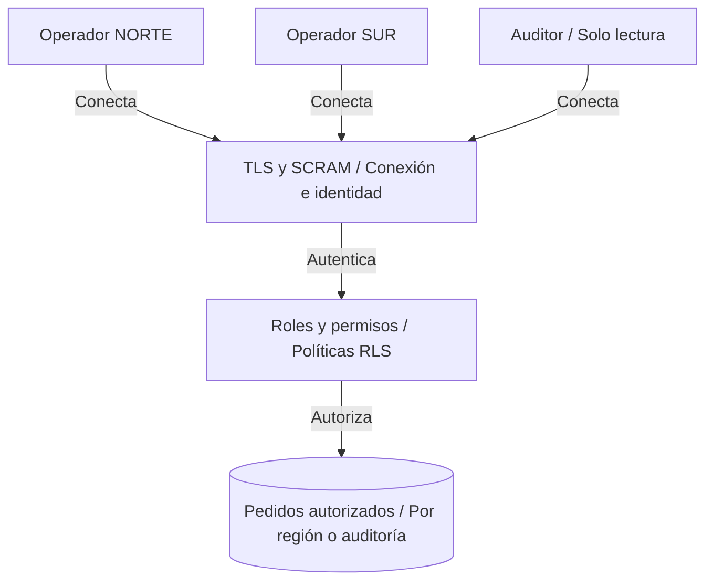
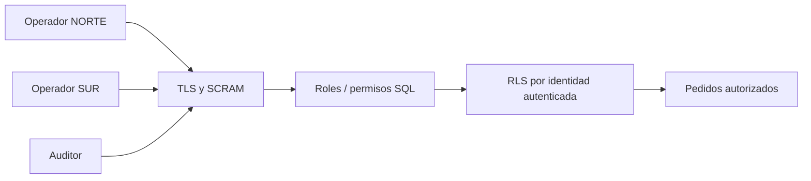

# Capítulo 6. Seguridad



*TLS protege la conexión, SCRAM autentica y las políticas RLS limitan los datos de los operadores a su región.*

[Anterior](../Capitulo05/README.md) · [Inicio](../README.md) · [Siguiente](../Capitulo07/README.md)

**Práctica 6.1 — usuarios, autenticación, permisos y datos protegidos.** Capítulo: 240 min; práctica: 100 min. Plan: roles 20, privilegios 15, RLS 25, TLS 25, pruebas 15 minutos.

## Misión y teoría

Andina necesita que cada operador vea y modifique pedidos de su región, y que auditoría consulte todo sin escribir. Reciba la réplica física activa, el ensayo lógico retirado y 2760.00 de venta consolidada.

Un rol `NOLOGIN` agrupa permisos; un rol `LOGIN` representa una identidad. SCRAM verifica credenciales; TLS cifra la conexión y `verify-full` valida certificado y nombre/IP del servidor. RLS filtra filas después de los permisos de objeto. Superusuarios y roles `BYPASSRLS` eluden políticas; el propietario normalmente también. Por ello se prueba con conexiones reales de operadores, no solo `SET ROLE` desde `postgres`.



Trabaje como `postgres` en `sales_pg`. Mantenga una conexión local de reparación. Para los ejercicios de cliente use una terminal nueva.

## Paso 1. Roles y permisos mínimos

```sql
CREATE ROLE app_ro NOLOGIN;
CREATE ROLE app_rw NOLOGIN;
CREATE ROLE operator_north LOGIN NOSUPERUSER NOCREATEDB NOCREATEROLE NOBYPASSRLS;
CREATE ROLE operator_south LOGIN NOSUPERUSER NOCREATEDB NOCREATEROLE NOBYPASSRLS;
CREATE ROLE auditor LOGIN NOSUPERUSER NOCREATEDB NOCREATEROLE NOBYPASSRLS;
\password operator_north
\password operator_south
\password auditor
GRANT app_rw TO operator_north,operator_south;
GRANT app_ro TO auditor;
REVOKE CONNECT,TEMPORARY ON DATABASE sales_pg FROM PUBLIC;
GRANT CONNECT ON DATABASE sales_pg TO lab_admin,app_ro,app_rw,logical_reader;
GRANT USAGE ON SCHEMA sales TO app_ro,app_rw;
GRANT SELECT ON ALL TABLES IN SCHEMA sales TO app_ro,app_rw;
GRANT INSERT,UPDATE,DELETE ON sales.orders,sales.order_items TO app_rw;
GRANT USAGE,SELECT ON SEQUENCE sales.orders_id_seq TO app_rw;
ALTER DEFAULT PRIVILEGES FOR ROLE lab_admin IN SCHEMA sales
GRANT SELECT ON TABLES TO app_ro,app_rw;
```

Los operadores pueden registrar pedidos y líneas, pero no administrar usuarios, catálogo, clientes ni el esquema `legacy`. Los privilegios por defecto aplican a objetos futuros creados por `lab_admin`, no por cualquier creador.

## Paso 2. Vincular identidad a región

El usuario no elige su región mediante una variable de sesión. La relación se mantiene en una tabla administrativa `ops` del capítulo 4:

```sql
SET ROLE lab_admin;
CREATE TABLE ops.user_regions (
 login_name name PRIMARY KEY,
 region text NOT NULL CHECK (region IN ('NORTE','CENTRO','SUR'))
);
INSERT INTO ops.user_regions VALUES
('operator_north','NORTE'),('operator_south','SUR');
CREATE FUNCTION ops.current_region() RETURNS text
LANGUAGE sql STABLE SECURITY DEFINER
SET search_path = pg_catalog
AS $$
 SELECT region FROM ops.user_regions WHERE login_name = session_user;
$$;
REVOKE ALL ON FUNCTION ops.current_region() FROM PUBLIC;
GRANT USAGE ON SCHEMA ops TO app_rw;
GRANT EXECUTE ON FUNCTION ops.current_region() TO app_rw;
RESET ROLE;
```

La función expone una región, no la tabla de asignaciones. Usa nombres cualificados y un `search_path` fijo. `session_user` representa el login original, incluso si cambia el rol efectivo. Proteja la función y su propietario como objetos administrativos.

## Paso 3. Aplicar seguridad a clientes, pedidos y líneas

```sql
ALTER TABLE sales.customers ENABLE ROW LEVEL SECURITY;
ALTER TABLE sales.orders ENABLE ROW LEVEL SECURITY;
ALTER TABLE sales.order_items ENABLE ROW LEVEL SECURITY;
CREATE POLICY customer_region ON sales.customers FOR SELECT TO app_rw
USING (region = ops.current_region());
CREATE POLICY customer_audit ON sales.customers FOR SELECT TO app_ro
USING (true);
CREATE POLICY order_region ON sales.orders FOR ALL TO app_rw
USING (EXISTS (
 SELECT 1 FROM sales.customers c
 WHERE c.id=customer_id AND c.region=ops.current_region()
))
WITH CHECK (EXISTS (
 SELECT 1 FROM sales.customers c
 WHERE c.id=customer_id AND c.region=ops.current_region()
));
CREATE POLICY order_audit ON sales.orders FOR SELECT TO app_ro USING (true);
CREATE POLICY item_region ON sales.order_items FOR ALL TO app_rw
USING (EXISTS (SELECT 1 FROM sales.orders o WHERE o.id=order_id))
WITH CHECK (EXISTS (SELECT 1 FROM sales.orders o WHERE o.id=order_id));
CREATE POLICY item_audit ON sales.order_items FOR SELECT TO app_ro USING (true);
ALTER VIEW sales.order_totals SET (security_invoker=true);
```

`security_invoker` hace que la vista use permisos y políticas del invocador. Sin esta decisión, una vista del propietario podría exponer datos que no corresponden al operador. No combine por conveniencia `app_ro` y `app_rw` en un operador: las políticas permisivas se combinan con OR y el permiso de auditoría abriría todas las filas.

## Paso 4. Configurar TLS del laboratorio

En `pg-primary`, genere un certificado autocertificado **solo para este entorno**. Una instalación empresarial utiliza certificados de su PKI. SAN incluye la IP real de ejemplo y loopback para las pruebas:

```bash
sudo apt install -y openssl
sudo openssl req -x509 -newkey rsa:3072 -nodes -days 30 \
  -keyout /etc/postgresql/16/main/server.key \
  -out /etc/postgresql/16/main/server.crt \
  -subj '/CN=pg-primary' \
  -addext 'subjectAltName=DNS:pg-primary,DNS:localhost,IP:192.168.56.10,IP:127.0.0.1'
sudo chown postgres:postgres /etc/postgresql/16/main/server.key /etc/postgresql/16/main/server.crt
sudo chmod 600 /etc/postgresql/16/main/server.key
sudo chmod 644 /etc/postgresql/16/main/server.crt
sudo -u postgres psql -X -d sales_pg
```

```sql
ALTER SYSTEM SET ssl = 'on';
ALTER SYSTEM SET ssl_cert_file = '/etc/postgresql/16/main/server.crt';
ALTER SYSTEM SET ssl_key_file = '/etc/postgresql/16/main/server.key';
ALTER SYSTEM SET ssl_min_protocol_version = 'TLSv1.2';
```

Edite el HBA del primario. **Reemplace** las reglas anteriores de `sales_pg` y `replication` usadas en los capítulos 2/5 por las siguientes; ubíquelas antes de reglas remotas más amplias. Mantenga los accesos locales `peer` para `postgres`:

```text
hostnossl sales_pg all 127.0.0.1/32 reject
hostnossl sales_pg all 192.168.56.0/24 reject
hostssl sales_pg lab_admin,operator_north,operator_south,auditor 127.0.0.1/32 scram-sha-256
hostssl sales_pg lab_admin,operator_north,operator_south,auditor 192.168.56.30/32 scram-sha-256
hostnossl replication repl_user 192.168.56.11/32 reject
hostssl replication repl_user 192.168.56.11/32 scram-sha-256
```

Desde la sesión local de `postgres`:

```sql
SELECT pg_reload_conf();
SELECT line_number,error FROM pg_hba_file_rules WHERE error IS NOT NULL;
SHOW ssl;
```

Si `SHOW ssl` aún no refleja el cambio, revise errores de recarga y certificado. Una conexión nueva debe negociar TLS. HBA no desconecta sesiones que ya existían.

En la estación DBA, copie únicamente el certificado público a una ruta local, mediante SSH. Sustituya `usuario_linux` por su cuenta real:

```bash
scp usuario_linux@192.168.56.10:/etc/postgresql/16/main/server.crt /tmp/andina-server.crt
psql -X 'host=192.168.56.10 dbname=sales_pg user=operator_north sslmode=verify-full sslrootcert=/tmp/andina-server.crt' -W
```

Si la estación es Windows, utilice una ruta local válida en `sslrootcert` en lugar de `/tmp`; el resto de parámetros es equivalente. Nunca copie la clave privada `server.key`.

Para validar la **réplica física** con TLS, copie también el certificado público al standby y déjelo legible por `postgres`:

```bash
# En pg-standby, con la cuenta Linux que tiene SSH al primario:
scp usuario_linux@192.168.56.10:/etc/postgresql/16/main/server.crt /tmp/andina-primary.crt
sudo install -o postgres -g postgres -m 600 /tmp/andina-primary.crt /var/lib/postgresql/andina-primary.crt
sudo -u postgres psql -X -d sales_pg
```

En esa sesión del standby, como `postgres`:

```sql
ALTER SYSTEM SET primary_conninfo = 'host=192.168.56.10 port=5432 user=repl_user application_name=andina_standby passfile=/var/lib/postgresql/.pgpass sslmode=verify-full sslrootcert=/var/lib/postgresql/andina-primary.crt';
SELECT pg_reload_conf();
```

Espere reconexión y confirme `streaming`. Estos parámetros de instancia no se escriben por WAL en el primario; son configuración local del standby.

## Paso 5. Pruebas reales de autorización

En la conexión `operator_north` con TLS:

```sql
SELECT session_user,current_user,ops.current_region();
SELECT ssl,version,cipher FROM pg_stat_ssl WHERE pid=pg_backend_pid();
SELECT id,name,region FROM sales.customers ORDER BY id;
SELECT id,total FROM sales.order_totals ORDER BY id;
SELECT SUM(total) AS ventas_visibles FROM sales.order_totals;
BEGIN;
INSERT INTO sales.orders(customer_id,status) VALUES (1,'CONFIRMED')
RETURNING id AS secure_order_id \gset
INSERT INTO sales.order_items VALUES (:secure_order_id,2,1,80.00);
ROLLBACK;
```

Espere clientes 1/101, pedidos 1/101 y ventas 1960.00. La venta temporal se revierte. Como **pruebas negativas separadas**, fuera de ese bloque:

```sql
INSERT INTO sales.orders(customer_id,status) VALUES (102,'CONFIRMED');
UPDATE sales.products SET price=1 WHERE id=1;
SELECT * FROM ops.user_regions;
```

Cada sentencia debe rechazarse: región ajena, falta de permiso de catálogo y falta de permiso de asignaciones. Una sesión con `ON_ERROR_STOP` puede cerrarse tras el primer error; ejecute cada prueba en una nueva sesión o sin esa opción. No continúe una transacción abortada sin `ROLLBACK`.

Conecte `operator_south`: debe ver clientes 3/102, pedido 102 y venta 300.00. Conecte `auditor`: debe ver los cuatro pedidos y 2760.00, pero un `DELETE FROM sales.orders WHERE false` debe fallar por permisos. Pruebe además desde la estación un `sslmode=disable`: HBA debe rechazar la conexión.

Como `postgres` en primario confirme el streaming cifrado:

```sql
SELECT r.application_name,r.state,s.ssl,s.version
FROM pg_stat_replication r JOIN pg_stat_ssl s USING(pid);
SELECT COUNT(*) AS pedidos,SUM(total) AS venta FROM sales.order_totals;
```

## Ejercicios y aceptación

1. Explique por qué un GUC editable por el cliente no es una identidad regional confiable.
2. Diferencie una operación rechazada de un `UPDATE 0` sobre filas ocultas por RLS.
3. Proponga rotación y expiración de certificados sin interrumpir la réplica.
4. Revise qué privilegios recibiría una tabla nueva creada por `postgres` en vez de `lab_admin`.

| Prueba | Esperado | Observado |
|---|---|---|
| NORTE | 2 pedidos / 1960.00 | Pendiente |
| SUR | 1 pedido / 300.00 | Pendiente |
| Auditor | 4 pedidos / 2760.00; escritura rechazada | Pendiente |
| Región ajena / catálogo / asignaciones | Operaciones rechazadas | Pendiente |
| TLS | Cliente y réplica cifrados; conexión sin TLS rechazada | Pendiente |
| Entrega | Sin ventas de prueba persistidas | Pendiente |

Si el operador ve todo, revise membresías, `rolsuper`, `rolbypassrls`, propietario y `security_invoker`. Si ve cero filas, revise `session_user` y la asignación regional. Si el standby pierde conexión tras TLS, revise CA, SAN, caducidad y permisos; no solucione desactivando validación en la entrega.

Referencias: [RLS](https://www.postgresql.org/docs/16/ddl-rowsecurity.html), [políticas](https://www.postgresql.org/docs/16/sql-createpolicy.html), [TLS de cliente](https://www.postgresql.org/docs/16/libpq-ssl.html).
