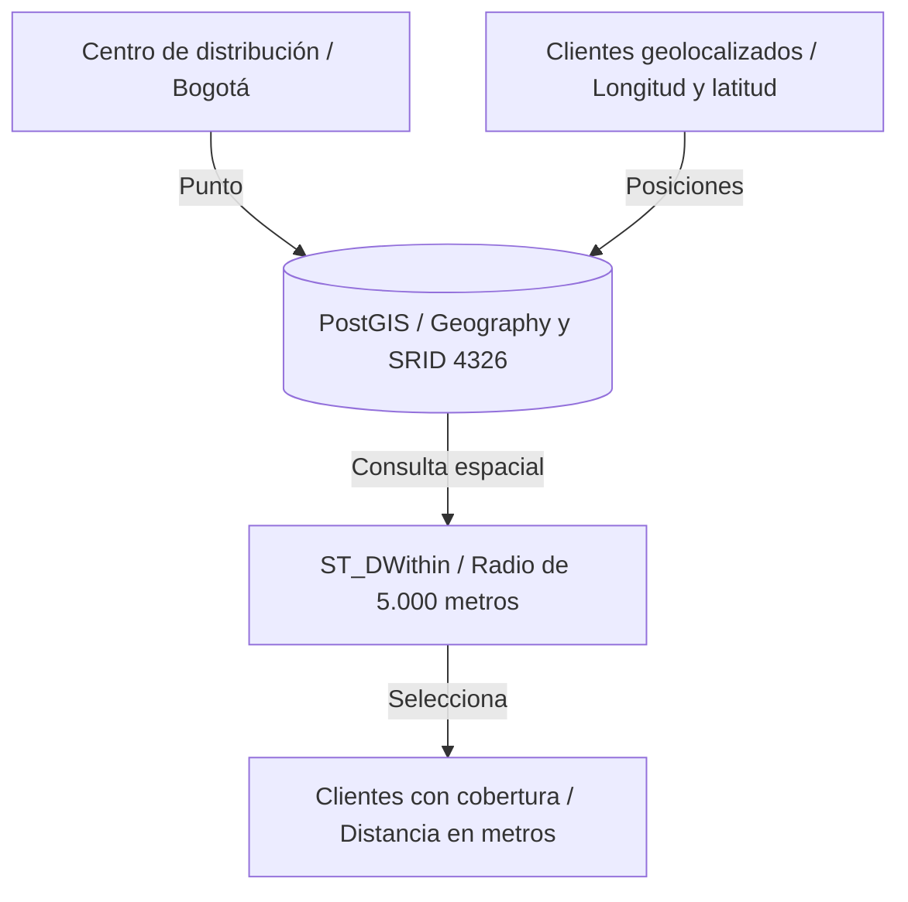
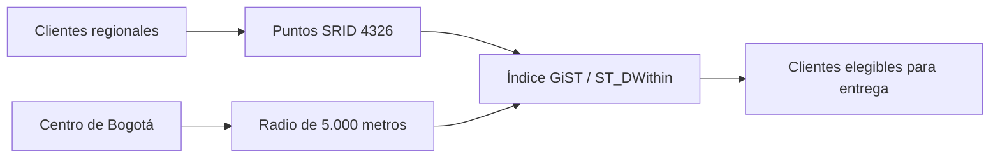

# Capítulo 7. Extensiones y casos de uso especializados



*Los puntos de clientes y el centro de distribución se comparan con ST_DWithin para identificar cobertura dentro de 5 km.*

[Anterior](../Capitulo06/README.md) · [Inicio](../README.md) · [Siguiente](../Capitulo08/README.md)

**Práctica 7.1 — cobertura de entregas con PostGIS.** Capítulo: 180 min; práctica: 85 min. Plan: extensión 15, modelo espacial 20, consultas 25, índice 15, aceptación 10 minutos.

## Misión y fundamentos

Andina necesita identificar clientes a menos de 5 km del centro de distribución en Bogotá. Reciba la base y seguridad del capítulo 6. Las coordenadas son ficticias y sirven para análisis de proximidad, no para calcular rutas viales.

Una extensión añade tipos, funciones e índices. `geometry` calcula según las unidades del sistema de referencia; `geography` modela posiciones sobre la Tierra y usa metros en consultas de distancia. SRID 4326 representa coordenadas geográficas; `ST_MakePoint` recibe **longitud, latitud**. Un índice GiST permite filtrar candidatos espaciales. `ST_DWithin` es apropiado para búsqueda por radio y admite uso de índice; [PostGIS documenta unidades y comportamiento](https://postgis.net/docs/ST_DWithin.html).



## Paso 1. Instalar PostGIS en ambos nodos físicos

Los binarios de una extensión no se replican por WAL. Instale el paquete **primero en pg-standby y después en pg-primary** para que la réplica pueda consultar datos espaciales. No cree la extensión manualmente en la réplica física; ese DDL llegará desde el primario.

```bash
sudo apt update
sudo apt install -y postgresql-16-postgis-3 postgresql-16-postgis-3-scripts
```

En `pg-primary`, como `postgres` en `sales_pg`:

```sql
SELECT name,default_version,installed_version
FROM pg_available_extensions WHERE name='postgis';
CREATE EXTENSION postgis;
SELECT PostGIS_Full_Version();
SELECT extname,extversion FROM pg_extension;
```

Resultado: extensión instalada. Si no aparece como disponible, revise la versión del paquete y el servidor conectado; instalar PostGIS para 18 no habilita automáticamente 16.

## Paso 2. Crear datos espaciales con políticas regionales

Se usa una tabla auxiliar para no alterar las columnas de las tablas de ventas:

```sql
SET ROLE lab_admin;
CREATE TABLE sales.customer_locations (
 customer_id bigint PRIMARY KEY REFERENCES sales.customers(id),
 location public.geography(Point,4326) NOT NULL
);
CREATE TABLE sales.warehouses (
 id integer PRIMARY KEY,
 name text NOT NULL,
 location public.geography(Point,4326) NOT NULL
);
INSERT INTO sales.warehouses VALUES
(1,'Centro Bogotá',public.ST_SetSRID(public.ST_MakePoint(-74.0721,4.7110),4326)::public.geography);
INSERT INTO sales.customer_locations VALUES
(1,public.ST_SetSRID(public.ST_MakePoint(-74.0600,4.7200),4326)::public.geography),
(2,public.ST_SetSRID(public.ST_MakePoint(-74.0800,4.7000),4326)::public.geography),
(3,public.ST_SetSRID(public.ST_MakePoint(-74.1500,4.6000),4326)::public.geography),
(101,public.ST_SetSRID(public.ST_MakePoint(-74.0650,4.7300),4326)::public.geography),
(102,public.ST_SetSRID(public.ST_MakePoint(-74.1600,4.5900),4326)::public.geography);
CREATE INDEX customer_locations_gist ON sales.customer_locations USING gist(location);
ALTER TABLE sales.customer_locations ENABLE ROW LEVEL SECURITY;
CREATE POLICY location_region ON sales.customer_locations FOR SELECT TO app_rw
USING (EXISTS (SELECT 1 FROM sales.customers c WHERE c.id=customer_id));
CREATE POLICY location_audit ON sales.customer_locations FOR SELECT TO app_ro USING(true);
RESET ROLE;
```

Los permisos SELECT se heredan de los privilegios por defecto del capítulo 6 porque `lab_admin` creó los objetos. Las coordenadas también son datos de cliente; RLS evita que una consulta directa exponga posiciones de otras regiones. El centro de distribución es información compartida.

## Paso 3. Distancias, cobertura y cliente más cercano

Como `postgres` en el primario, para ver el conjunto completo:

```sql
SELECT c.id,c.name,
       ROUND(public.ST_Distance(l.location,w.location)::numeric,0) AS metros
FROM sales.customers c JOIN sales.customer_locations l ON l.customer_id=c.id
CROSS JOIN sales.warehouses w WHERE w.id=1 ORDER BY metros;

SELECT c.id,c.name
FROM sales.customers c JOIN sales.customer_locations l ON l.customer_id=c.id
JOIN sales.warehouses w ON w.id=1
WHERE public.ST_DWithin(l.location,w.location,5000)
ORDER BY c.id;

SELECT c.id,c.name
FROM sales.customers c JOIN sales.customer_locations l ON l.customer_id=c.id
CROSS JOIN sales.warehouses w WHERE w.id=1
ORDER BY public.ST_Distance(l.location,w.location) LIMIT 1;
```

Resultado: clientes 1, 2 y 101 dentro de 5 km; clientes 3 y 102 fuera. El cliente más cercano es 2. Las distancias concretas pueden variar ligeramente según la versión; no equivalen a kilómetros de carretera.

Para visualizar coordenadas en pantalla:

```sql
SELECT customer_id,public.ST_AsText(location::public.geometry) AS punto
FROM sales.customer_locations ORDER BY customer_id;
SELECT customer_id,public.ST_SRID(location::public.geometry) AS srid,
       public.ST_IsValid(location::public.geometry) AS valido
FROM sales.customer_locations;
```

Todos deben tener SRID 4326 y ser válidos. Un SRID correcto no corrige por sí mismo una longitud/latitud invertida: revise también el rango y el contexto.

## Paso 4. Observar el plan y preservar seguridad

```sql
ANALYZE sales.customer_locations;
EXPLAIN (ANALYZE,BUFFERS)
SELECT customer_id FROM sales.customer_locations
WHERE public.ST_DWithin(location,
 public.ST_SetSRID(public.ST_MakePoint(-74.0721,4.7110),4326)::public.geography,5000);
```

Con cinco filas el optimizador puede preferir `Seq Scan`; eso no invalida el índice. Para estudiar la alternativa, en una transacción de diagnóstico:

```sql
BEGIN;
SET LOCAL enable_seqscan=off;
EXPLAIN SELECT customer_id FROM sales.customer_locations
WHERE public.ST_DWithin(location,
 public.ST_SetSRID(public.ST_MakePoint(-74.0721,4.7110),4326)::public.geography,5000);
ROLLBACK;
```

No conserve `enable_seqscan=off` como ajuste de rendimiento.

Conecte `operator_north` usando la conexión TLS del capítulo 6 y repita la consulta de cobertura: debe devolver solo 1 y 101. Una consulta directa a `customer_locations` también debe devolver dos filas. `operator_south` ve dos posiciones, pero ninguna dentro del radio. `auditor` ve las cinco posiciones y tres clientes cubiertos.

En `pg-standby`, como `postgres`:

```sql
SELECT PostGIS_Full_Version();
SELECT COUNT(*) FROM sales.customer_locations;
```

Espere 5 filas después de que el replay alcance el DDL y la carga.

## Ejercicios y aceptación

1. Cambie el radio a 2 km y documente los clientes que quedan; vuelva a 5 km en su evidencia de entrega.
2. Compare `ST_Distance` para `geometry(4326)` y `geography`: explique por qué no se interpreta el primer resultado como metros.
3. Diseñe una tabla de zonas poligonales y explique cuándo usar `ST_Contains` frente a `ST_Covers`, especialmente en el borde. Es un diseño conceptual; no modifica la entrega.
4. Explique la diferencia entre `ST_SetSRID` (asignar referencia) y `ST_Transform` (convertir coordenadas).

| Control | Esperado | Observado |
|---|---|---|
| PostGIS | Disponible en primario y standby | Pendiente |
| Datos | 5 posiciones / 1 centro / SRID 4326 | Pendiente |
| Cobertura global | 1, 2, 101 a menos de 5 km | Pendiente |
| Seguridad espacial | NORTE 2 posiciones; SUR 2; auditor 5 | Pendiente |
| Negocio conservado | 4 pedidos / 2760.00 | Pendiente |

Si aparece `type geography does not exist`, confirme base y extensión. Si el standby no puede cargar una biblioteca, instale el paquete en su sistema operativo. Si una distancia es inesperada, revise orden de coordenadas, tipo y unidades antes de cambiar el radio.

**Entrega:** extensión, tablas e índice activos; ventas intactas. Referencias: [PostGIS](https://postgis.net/docs/), [ST_DWithin](https://postgis.net/docs/ST_DWithin.html), [ST_Transform](https://postgis.net/docs/ST_Transform.html).
