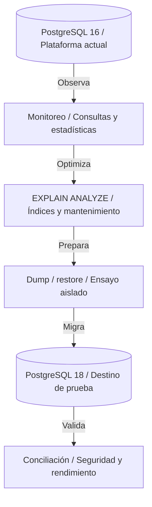
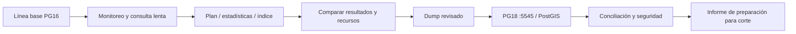

# Capítulo 8. Actualización, estadísticas y monitoreo



*La optimización se demuestra con planes y medidas; la actualización se ensaya en PostgreSQL 18 y se valida antes de un corte futuro.*

[Anterior](../Capitulo07/README.md) · [Inicio](../README.md)

**Práctica 8.1 — optimización verificable y ensayo de PostgreSQL 16 a 18.** Capítulo: 300 min; práctica: 150 min. Plan: monitoreo 25, volumen y planes 30, estadísticas/mantenimiento 25, ensayo de actualización 50, aceptación 20 minutos.

## Misión y fundamentos

Andina proyecta crecimiento y necesita justificar cambios mediante evidencia. Reciba la plataforma del capítulo 7 con TLS, RLS, PostGIS y réplica física. Genere volumen en una **tabla separada**, compare planes y ensaye PostgreSQL 18 sin cambiar el primario 16.

Una actualización menor conserva la versión mayor; una mayor requiere un procedimiento de migración. `pg_upgrade` evita reconstruir todo lógicamente, pero exige comprobar compatibilidad y extensiones; dump/restore es más portable y permite un destino independiente. Se usa dump/restore 16→18 en este laboratorio. [PostgreSQL documenta las alternativas de actualización](https://www.postgresql.org/docs/18/upgrading.html).

`pg_stat_activity` muestra actividad actual; `pg_stat_statements` agrega consultas normalizadas; `EXPLAIN` muestra estimaciones y `EXPLAIN ANALYZE` **ejecuta** la sentencia. Estadísticas y distribución de datos determinan cardinalidades. Un índice tiene coste de almacenamiento y escritura; no todo `Seq Scan` es un problema. `VACUUM` recupera reutilización de espacio y visibilidad, mientras `ANALYZE` actualiza estimaciones.



Requisitos: `sudo`, espacio para dump y clúster adicional, puerto 5545 libre, repositorio PGDG y extensión PostGIS para 18. El ensayo no promueve el standby ni cambia endpoints.

## Paso 1. Habilitar y observar monitoreo

En `pg-primary`, como `postgres` en `sales_pg`:

```sql
SHOW shared_preload_libraries;
```

En este proyecto se presupone vacío. Si ya existen bibliotecas, consérvelas y **añada** `pg_stat_statements` a la lista en lugar de reemplazarlas.

```sql
ALTER SYSTEM SET shared_preload_libraries = 'pg_stat_statements';
\q
```

```bash
sudo pg_ctlcluster 16 main restart
sudo -u postgres psql -X -v ON_ERROR_STOP=1 -d sales_pg
```

```sql
CREATE EXTENSION pg_stat_statements;
SELECT pid,usename,state,wait_event_type,wait_event,
       pg_blocking_pids(pid) AS bloqueadores
FROM pg_stat_activity WHERE datname='sales_pg';
SELECT datname,numbackends,xact_commit,xact_rollback,deadlocks,
       blks_read,blks_hit FROM pg_stat_database WHERE datname='sales_pg';
SELECT application_name,state,sync_state FROM pg_stat_replication;
```

La biblioteca forma parte de la instalación PostgreSQL correspondiente; compruebe su disponibilidad en el standby antes de consultar la extensión allí. La configuración de preloading es local, no replicada. Consulte [los requisitos de pg_stat_statements](https://www.postgresql.org/docs/16/pgstatstatements.html).

## Paso 2. Generar un conjunto de volumen independiente

Como `postgres`, establezca el propietario del proyecto para crear la tabla:

```sql
SET ROLE lab_admin;
CREATE TABLE sales.performance_orders (
 id bigint PRIMARY KEY,
 customer_id bigint NOT NULL,
 ordered_at timestamptz NOT NULL,
 status text NOT NULL,
 amount numeric(12,2) NOT NULL
);
-- Datos sintéticos: no sustituyen las ventas del proyecto.
INSERT INTO sales.performance_orders
SELECT g,
       CASE WHEN g%10=0 THEN 101 WHEN g%10=1 THEN 102 ELSE 1 END,
       TIMESTAMPTZ '2025-01-01 00:00:00+00' + (g%365)*INTERVAL '1 day',
       CASE WHEN g%5=0 THEN 'CONFIRMED' ELSE 'SHIPPED' END,
       (20 + g%1000)::numeric(12,2)
FROM generate_series(1,200000) AS s(g);
-- Solo DBA analiza esta tabla de ensayo.
REVOKE SELECT ON sales.performance_orders FROM app_ro,app_rw;
RESET ROLE;
ANALYZE sales.performance_orders;
SELECT COUNT(*) FROM sales.performance_orders;
```

Espere 200.000 filas y todavía 4 pedidos reales / 2760.00 en `sales.order_totals`. La carga genera WAL; supervise disco, archivado y atraso del standby.

## Paso 3. Medir consulta e incorporar un índice

Como `postgres`, active tiempos en `psql` y ejecute varias veces la misma consulta; compare ejecuciones equivalentes considerando caché:

```sql
\timing on
EXPLAIN (ANALYZE,BUFFERS)
SELECT COUNT(*),SUM(amount)
FROM sales.performance_orders
WHERE customer_id=101
  AND ordered_at >= TIMESTAMPTZ '2025-12-01 00:00:00+00'
  AND ordered_at <  TIMESTAMPTZ '2025-12-08 00:00:00+00';

CREATE INDEX performance_customer_date_idx
ON sales.performance_orders(customer_id,ordered_at) INCLUDE(amount);
VACUUM (ANALYZE) sales.performance_orders;

EXPLAIN (ANALYZE,BUFFERS)
SELECT COUNT(*),SUM(amount)
FROM sales.performance_orders
WHERE customer_id=101
  AND ordered_at >= TIMESTAMPTZ '2025-12-01 00:00:00+00'
  AND ordered_at <  TIMESTAMPTZ '2025-12-08 00:00:00+00';
```

Compare nodos, filas estimadas/reales, buffers y tiempo. Puede aparecer `Index Only Scan` si las páginas están marcadas como visibles; el plan no es idéntico en todas las VM. Ejecute la consulta sin `EXPLAIN` antes/después: conteo e importe deben ser iguales. No declare una mejora solo porque se creó el índice.

Esta creación bloqueante es aceptable en la tabla de ensayo. En una tabla operativa evalúe `CREATE INDEX CONCURRENTLY`, que no se ejecuta dentro de un bloque transaccional y tiene condiciones operativas propias.

## Paso 4. Estadísticas correlacionadas y mantenimiento

La generación produjo una dependencia: todos los pedidos del cliente 101 son `CONFIRMED`. Observe la estimación antes y después:

```sql
EXPLAIN (ANALYZE,BUFFERS)
SELECT COUNT(*) FROM sales.performance_orders
WHERE customer_id=101 AND status='CONFIRMED';
CREATE STATISTICS sales.performance_customer_status (dependencies,mcv)
ON customer_id,status FROM sales.performance_orders;
ANALYZE sales.performance_orders;
EXPLAIN (ANALYZE,BUFFERS)
SELECT COUNT(*) FROM sales.performance_orders
WHERE customer_id=101 AND status='CONFIRMED';

SELECT schemaname,tablename,attname,n_distinct,most_common_vals
FROM pg_stats WHERE schemaname='sales' AND tablename='performance_orders';
SELECT relname,n_live_tup,n_dead_tup,last_vacuum,last_autovacuum,last_analyze
FROM pg_stat_user_tables WHERE schemaname='sales';
SELECT queryid,calls,total_exec_time,mean_exec_time,rows,query
FROM pg_stat_statements
WHERE dbid=(SELECT oid FROM pg_database WHERE datname='sales_pg')
ORDER BY total_exec_time DESC LIMIT 10;
```

Espere 20.000 filas reales para la combinación cliente/estado. Estadísticas extendidas pueden mejorar la estimación; no garantizan menor tiempo para cualquier consulta. `pg_stat_statements` acumula desde su habilitación y no representa automáticamente una ventana de negocio.

Como ejercicio, cambie `work_mem` solo en una sesión y compare una ordenación; restituya con `RESET work_mem`. Justifique memoria por consulta y concurrencia antes de proponer un cambio global. Evite `VACUUM FULL` como mantenimiento rutinario, por bloqueo y reescritura. Verifique autovacuum en vez de desactivarlo.

## Paso 5. Preparar PostgreSQL 18 aislado

En `pg-primary`, instale binarios y PostGIS. El empaquetado puede crear automáticamente `18/main` en otro puerto; inspeccione y no lo use por accidente. El destino del ensayo es **18/upgrade**, puerto **5545**:

```bash
sudo apt update
sudo apt install -y postgresql-18 postgresql-client-18 postgresql-18-postgis-3 postgresql-18-postgis-3-scripts
pg_lsclusters
sudo pg_createcluster 18 upgrade --port 5545 --start
sudo -u postgres /usr/lib/postgresql/18/bin/psql -X -p 5545 -d postgres -c 'SELECT version();'
```

Si `18/upgrade` ya existe, inspeccione su contenido y no lo sobrescriba. El ensayo requiere un clúster nuevo sin roles del proyecto ni `sales_pg`. Mantenga el destino accesible solo localmente. No copie `postgresql.auto.conf` de 16 a 18 ni active sincronía apuntando al standby 16.

En `18/upgrade`, habilite la biblioteca estadística antes de restaurar la extensión:

```bash
sudo -u postgres /usr/lib/postgresql/18/bin/psql -X -p 5545 -d postgres \
  -c "ALTER SYSTEM SET shared_preload_libraries='pg_stat_statements';"
sudo pg_ctlcluster 18 upgrade restart
```

## Paso 6. Ensayar dump/restore 16 → 18

Mantenga la aplicación sin escrituras durante la captura. Un dump es consistente, pero no incluye modificaciones posteriores; el ensayo no realiza CDC ni cambia la conexión de la aplicación.

Use los clientes **18** explícitamente contra el servidor **16**. Replique roles sin contraseñas para que el destino de ensayo no abra accesos con secretos heredados. El rol `postgres` ya existe en el clúster nuevo: se excluye solo su instrucción `CREATE ROLE`, manteniendo los demás atributos y membresías:

```bash
set -o pipefail
sudo -u postgres /usr/lib/postgresql/18/bin/pg_dumpall \
  -p 5432 --globals-only --no-role-passwords | \
  sed '/^CREATE ROLE postgres;$/d' | \
  sudo -u postgres /usr/lib/postgresql/18/bin/psql -X -v ON_ERROR_STOP=1 -p 5545 -d postgres

sudo -u postgres /usr/lib/postgresql/18/bin/pg_dump \
  -p 5432 -d sales_pg -Fc --create -f /srv/andina-backups/sales08-for18.dump
sudo -u postgres /usr/lib/postgresql/18/bin/pg_restore \
  -p 5545 -d postgres --create --exit-on-error /srv/andina-backups/sales08-for18.dump
sudo -u postgres /usr/lib/postgresql/18/bin/vacuumdb -p 5545 -d sales_pg --analyze-in-stages
```

`--create` preserva creación y propiedades de la base. Roles, membresías y objetos se restauran; las contraseñas se configuran aparte con `\password` si se habilitan accesos posteriormente. Un segundo intento de restauración no debe hacerse sobre una base parcialmente restaurada sin analizar el fallo. Las bibliotecas de extensiones deben ser compatibles con 18; compare las versiones instaladas y las notas de cambio.

## Paso 7. Validar el destino y documentar el corte futuro

En `18/upgrade`, como `postgres`:

```bash
sudo -u postgres /usr/lib/postgresql/18/bin/psql -X -p 5545 -d sales_pg
```

```sql
SELECT version();
SELECT extname,extversion FROM pg_extension ORDER BY extname;
SELECT COUNT(*) AS pedidos,SUM(total) AS venta FROM sales.order_totals;
SELECT COUNT(*) FROM sales.performance_orders;
SELECT COUNT(*) FROM sales.customer_locations;
SELECT COUNT(*) FROM sales.warehouses;
SELECT * FROM ops.user_regions ORDER BY login_name;
SELECT schemaname,tablename,policyname,roles FROM pg_policies ORDER BY 1,2,3;
SELECT relname,reloptions FROM pg_class
WHERE oid='sales.order_totals'::regclass;
SELECT public.PostGIS_Full_Version();
SELECT conrelid::regclass,conname FROM pg_constraint
WHERE connamespace IN ('sales'::regnamespace,'legacy'::regnamespace)
AND NOT convalidated;
SELECT c.relname FROM pg_index i JOIN pg_class c ON c.oid=i.indexrelid
WHERE NOT i.indisvalid;
```

Espere PostgreSQL 18.x, 4 pedidos / 2760.00, 200.000 filas sintéticas, 5 posiciones y 1 centro. No debe haber restricciones no validadas ni índices inválidos. Compare índices, políticas, propietarios, secuencias y el plan de la consulta optimizada. El dump no transporta datos estadísticos de monitoreo ni una réplica física compatible entre versiones mayores.

Para probar RLS en el destino sin habilitar red, use **conexiones locales nuevas** como `postgres` y cambie la identidad de sesión para este diagnóstico administrativo:

```sql
SET SESSION AUTHORIZATION operator_north;
SELECT session_user,current_user;
SELECT id,total FROM sales.order_totals ORDER BY id;
SELECT COUNT(*) FROM sales.customer_locations;
RESET SESSION AUTHORIZATION;
SET SESSION AUTHORIZATION auditor;
SELECT COUNT(*) AS pedidos,SUM(total) AS venta FROM sales.order_totals;
RESET SESSION AUTHORIZATION;
```

`SET SESSION AUTHORIZATION` es necesario porque la función regional usa `session_user`; `SET ROLE` desde `postgres` no simularía el login de operador. Espere pedidos 1/101 y dos posiciones para NORTE; auditor ve 4 pedidos / 2760.00. Esto prueba autorizaciones SQL; autenticación y TLS del destino requerirían su propia configuración y conexiones reales antes de un corte productivo.

El plan de corte futuro debe contemplar: ventana y congelación, copia final, conciliación, contraseñas/certificados, pruebas de aplicación, reconstrucción de standby en 18, endpoint nuevo y observación. Si la aplicación no ha escrito en 18, la reversión puede volver al 16 conservado. Tras escrituras en 18, volver a 16 requiere reconciliarlas; no suponga reversión automática.

## Ejercicios y aceptación final

1. Compare dump/restore y `pg_upgrade --check`: tiempo, espacio, extensiones, ventanas y reversión. El ensayo ejecutado aquí es dump/restore.
2. Registre buffers y tiempos con caché comparable; explique una mejora o la ausencia de mejora.
3. Proponga alarmas para bloqueos prolongados, conexiones, archivado, WAL retenido, atraso de réplica, disco y caducidad TLS.
4. Diseñe una revisión mensual de estadísticas, índices, autovacuum y restauraciones de prueba.

| Control | Antes | Después / esperado | Observado |
|---|---|---|---|
| Consulta por cliente/fecha | Plan y buffers sin índice | Mismo resultado; plan medido con índice | Pendiente |
| Cardinalidad correlacionada | Estimación inicial | Comparada con 20.000 filas reales | Pendiente |
| Negocio en 18 | 4 pedidos / 2760.00 en 16 | 4 pedidos / 2760.00 en 18 | Pendiente |
| Extensiones y geografía | PostGIS, estadísticas, 5 posiciones | Objetos y consultas disponibles | Pendiente |
| Seguridad en 18 | Roles, membresías, RLS y vista | Autorización regional preservada | Pendiente |
| Continuidad | Primario16 / standby16 | Operación conservada, sin corte | Pendiente |

Si el dump falla por versión, revise que se ejecuta el binario 18. Si la restauración falla en PostGIS, instale el paquete del destino y revise compatibilidad. Si `pg_stat_statements` exige preloading, confirme que se reinició **18/upgrade**, no otro clúster. Si cambia el plan, actualice estadísticas y compare distribución, parámetros y caché antes de atribuirlo a una regresión de versión.

Conserve el destino para revisión. Si necesita liberar RAM, detenga únicamente el ensayo:

```bash
sudo pg_ctlcluster 18 upgrade stop
```

**Entrega final:** informe de rendimiento y preparación de actualización en este README, primario 16 y standby operativos, datos de negocio conservados. Referencias: [actualización](https://www.postgresql.org/docs/18/upgrading.html), [EXPLAIN](https://www.postgresql.org/docs/16/using-explain.html), [estadísticas extendidas](https://www.postgresql.org/docs/16/planner-stats.html), [mantenimiento](https://www.postgresql.org/docs/16/routine-vacuuming.html).
